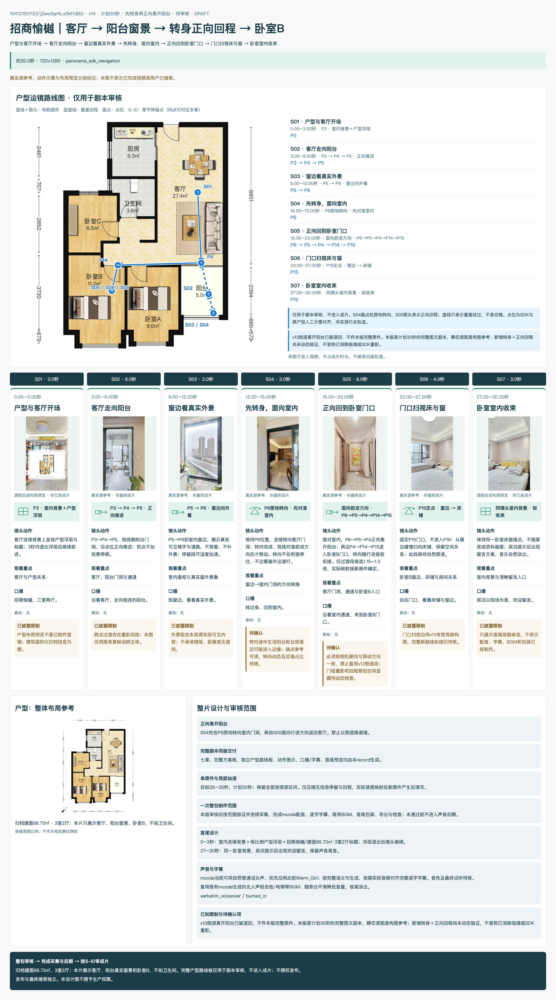
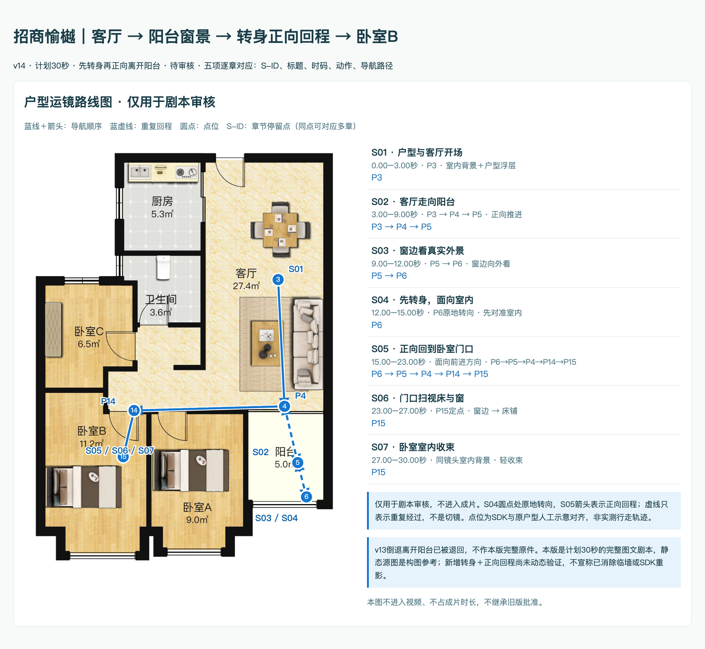
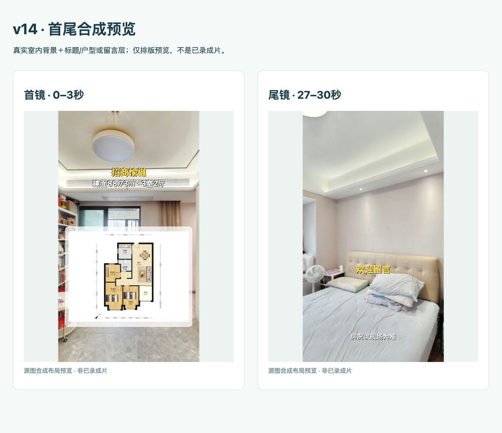
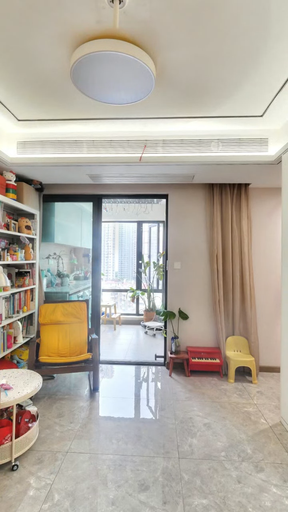
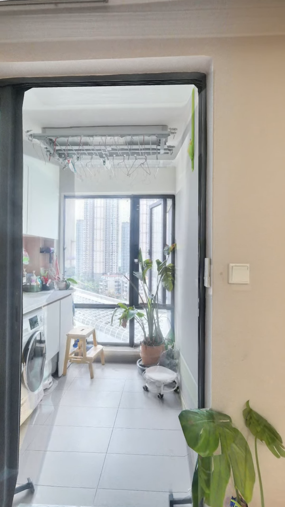
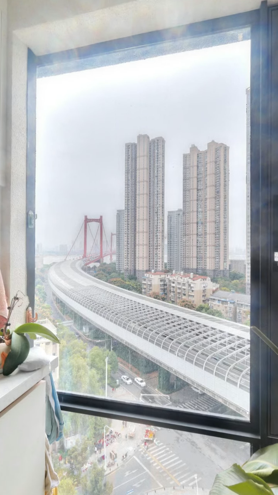
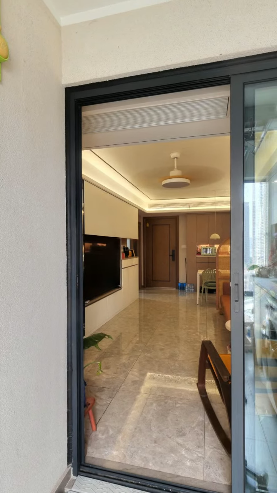
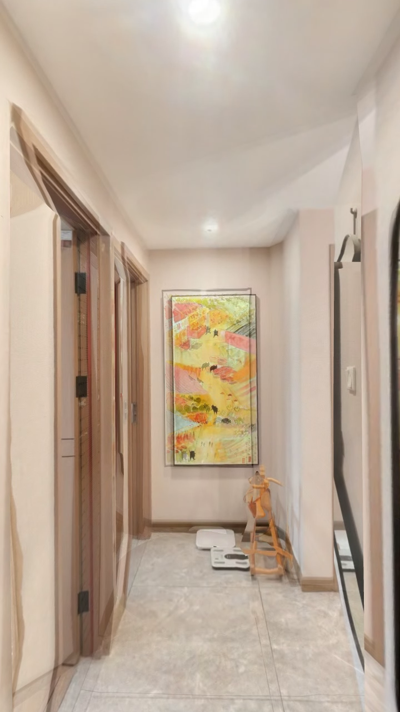
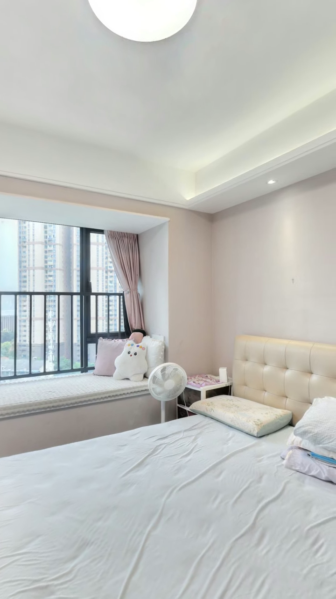
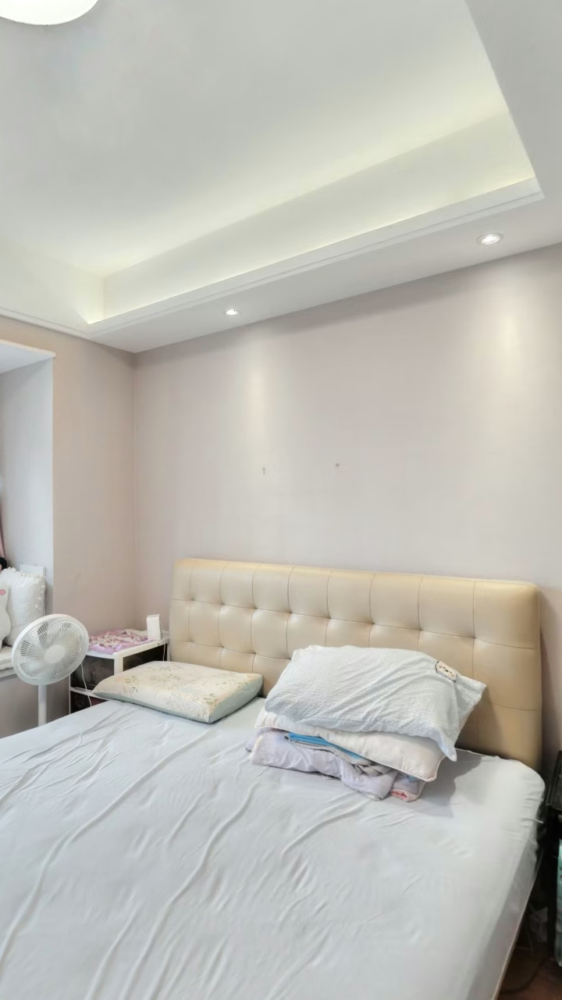

# 招商愉樾｜客厅 → 阳台窗景 → 转身正向回程 → 卧室B · v14 · 计划30秒 · 先转身再正向离开阳台 · 待审核

状态：DRAFT；方案板与本正文由同一record.json生成。

## 一、完整方案板

## 二、详细视频剧本

## 户型运镜路线图（仅用于剧本审核）

仅用于剧本审核，不进入成片。S04圆点处原地转向，S05箭头表示正向回程；虚线只表示重复经过，不是切镜。点位为SDK与原户型人工示意对齐，非实测行走轨迹。

## 首尾层次与字幕顺序

## 制作范围

- 房源：104121501123/jZwe3qrALx0M7dBG；方法：panorama_sdk_navigation；范围：model_only。
- 时长：30秒；配置：{"renderer": "Five6.6.20 / Three r117", "width": 720, "height": 1280, "dpr": 1, "fov_axis": "vertical", "fov_deg": 85.57, "near": 0.08, "far": 800}。
- opening：0–3秒：室内连续背景＋保比例户型浮层＋招商愉樾/建面88.73㎡·3室2厅标题；浮层退出后镜头继续。
- ending：27–30秒：同一卧室背景，房况提示后出现欢迎留言，保留声音尾音。
- bgm：复用既有mcode生成的无人声轻吉他/电钢琴BGM；随旁白平滑降低音量，收尾淡出。
- route：3→4→5→6→5→4→14→15
- facts_and_rights：归档建面88.73㎡、3室2厅；本片展示客厅、阳台真实窗景和卧室B，不拍卫生间。完整户型路线板仅用于剧本审核，不进入成片；不授权发布。
- 连续性与后期边界：{"single_take_required": true, "allow_cuts": false, "allow_remove_intervals": false, "allow_speed_changes": true}；绑定同一完整原件，变速不授予切镜。
- 覆盖：客餐厅、阳台与真实窗景、卧室B
- 字幕：verbatim_voiceover / burned_in。
- 授权范围：["capture", "voiceover", "opening", "ending", "subtitles", "bgm", "encode", "qc"]。
- 未授权：["本版尚未获整包制作批准", "倒退离开阳台", "硬切/删除中间段/拼不同原件", "拍摄卫生间", "穿窗或合成外景", "公开发布或新增未批准费用"]。
- 原户型图：../floorplan.png

## 调整与待审核项

- 正向离开阳台：S04先在P6原地转向室内门洞，再由S05面向行进方向返回客厅。禁止以倒退换避墙。
- 完整剧本同版交付：七章、完整方案板、独立户型路线板、动作图示、口播/字幕、首尾预览均由本record生成。
- 单原件与局部加速：目标25–35秒，计划30秒；保留全部连续源区间。仅压缩无信息停留与回程，实际速度映射在新原件产生后填写。
- 一次整包制作范围：本版审核后按范围验证并连续采集，完成mcode配音、逐字字幕、既有BGM、首尾包装、导出与检查；未通过前不进入声音后期。
- 限制：v13倒退离开阳台已被退回，不作本版完整原件。本版是计划30秒的完整图文剧本，静态源图是构图参考；新增转身＋正向回程尚未动态验证，不宣称已消除临墙或SDK重影。
- 事实口径：归档建面88.73㎡ · 3室2厅；本片只展示客厅、阳台窗景、卧室B，不拍卫生间。

## S01｜户型与客厅开场

- 时码：0–3秒。
- 布局：opening_composite；标题角色：opening。
- 动作图示：static / P3 · 室内背景＋户型浮层。
- action：客厅连续背景上呈现户型浮层与标题；3秒内退出浮层后继续前进。
- focus：客厅与户型关系
- text：招商愉樾，三室两厅。
- music：复用既有mcode生成的无人声轻吉他/电钢琴BGM；随旁白平滑降低音量，收尾淡出。
- risk：户型布局预览不是已制作首镜；建筑面积以归档信息为据。
- 黄标：。
- headline_lines：["招商愉樾", "建面88.73㎡ · 3室2厅"]

## S02｜客厅走向阳台

- 时码：3–9秒。
- 布局：source_reference；标题角色：chapter。
- 动作图示：travel / P3 → P4 → P5 · 正向推进。
- action：P3→P4→P5，视线朝阳台门洞，沿点位正向推进；到点不加找景停顿。
- focus：客厅、阳台门洞与通道
- text：沿着客厅，走向相连的阳台。
- music：复用既有mcode生成的无人声轻吉他/电钢琴BGM；随旁白平滑降低音量，收尾淡出。
- risk：跨点过渡存在重影风险；本图仅用既有真帧说明主体。
- 黄标：。

## S03｜窗边看真实外景

- 时码：9–12秒。
- 布局：source_reference；标题角色：chapter。
- 动作图示：travel / P5 → P6 · 窗边向外看。
- action：P5→P6到室内窗边，展示真实可见楼宇与道路，不穿窗、不补外景；停留段可适度加速。
- focus：室内窗框与真实窗外景象
- text：到窗边，看看真实外景。
- music：复用既有mcode生成的无人声轻吉他/电钢琴BGM；随旁白平滑降低音量，收尾淡出。
- risk：外景取自本房源实际可见内容；不承诺楼层、距离或无遮挡。
- 黄标：。

## S04｜先转身，面向室内

- 时码：12–15秒。
- 布局：source_reference；标题角色：chapter。
- 动作图示：pan / P6原地转向 · 先对准室内。
- action：保持P6位置，连续转向客厅门洞；转向完成、视线对准前进方向后才移动。转向不在柜面停住，不边看窗外边退行。
- focus：窗边→室内门洞的方向转换
- text：转过身，回到室内。
- music：复用既有mcode生成的无人声轻吉他/电钢琴BGM；随旁白平滑降低音量，收尾淡出。
- risk：转向途中生活阳台柜台或墙边可能进入边缘；端点参考可读，转向动态及近墙占比待核。
- 黄标：。

## S05｜正向回到卧室门口

- 时码：15–23秒。
- 布局：source_reference；标题角色：chapter。
- 动作图示：travel / 面向前进方向 · P6→P5→P4→P14→P15。
- action：面对室内，P6→P5→P4正向离开阳台；再沿P4→P14→P15进入卧室B门口，转向随行进提前衔接。仅过渡段候选1.15–1.3倍，实际映射按新原件确定。
- focus：客厅门洞、通道与卧室B入口
- text：沿着室内通道，来到卧室B门口。
- music：复用既有mcode生成的无人声轻吉他/电钢琴BGM；随旁白平滑降低音量，收尾淡出。
- risk：必须核相机朝向与移动方向一致，禁止复用v13倒退段；门框重影和回程禁拍空间显露待动态检查。
- 黄标：。

## S06｜门口扫视床与窗

- 时码：23–27秒。
- 布局：source_reference；标题角色：chapter。
- 动作图示：pan / P15定点 · 窗边 → 床铺。
- action：固定P15门口，不进入P16；从窗边缓慢扫向床铺，保留空间关系；此段保持自然原速。
- focus：卧室B窗边、床铺与房间关系
- text：站在门口，看看床铺与窗边。
- music：复用既有mcode生成的无人声轻吉他/电钢琴BGM；随旁白平滑降低音量，收尾淡出。
- risk：门口扫视沿用v13有效局部构图，完整新路线衔接仍待核。
- 黄标：。

## S07｜卧室室内收束

- 时码：27–30秒。
- 布局：ending_composite；标题角色：ending。
- 动作图示：static / 同镜头室内背景 · 轻收束。
- action：保持同一卧室床窗端点，不插黑底或资料画面；房况提示后出现留言文案，音乐自然淡出。
- focus：室内背景与清晰留言入口
- text：房况以现场为准，欢迎留言。
- music：复用既有mcode生成的无人声轻吉他/电钢琴BGM；随旁白平滑降低音量，收尾淡出。
- risk：只展示首尾排版候选，不表示配音、字幕、BGM和包装已经制作。
- 黄标：。
- cta："欢迎留言"
- disclaimer："房况以现场为准"

## 来源与审核边界

- 真实源参考不等于成片；动作图示不证明真实路径；首尾预览是排版设计。
- 本正文、方案板、图源与实际回读绑定后才能提交一次整包审核。机器检查不代替目视和用户接受。
