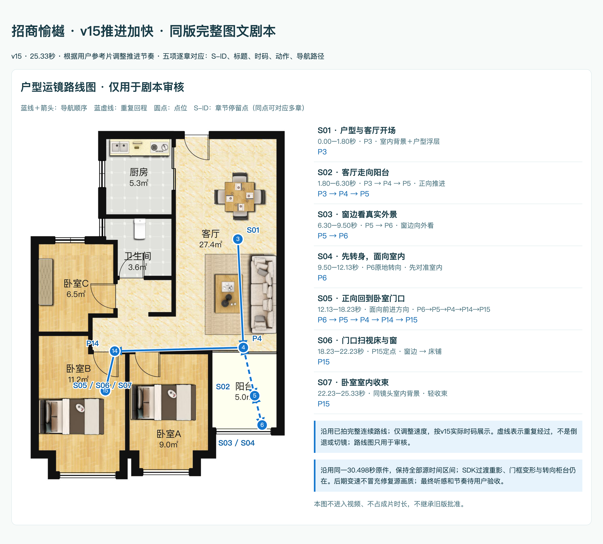
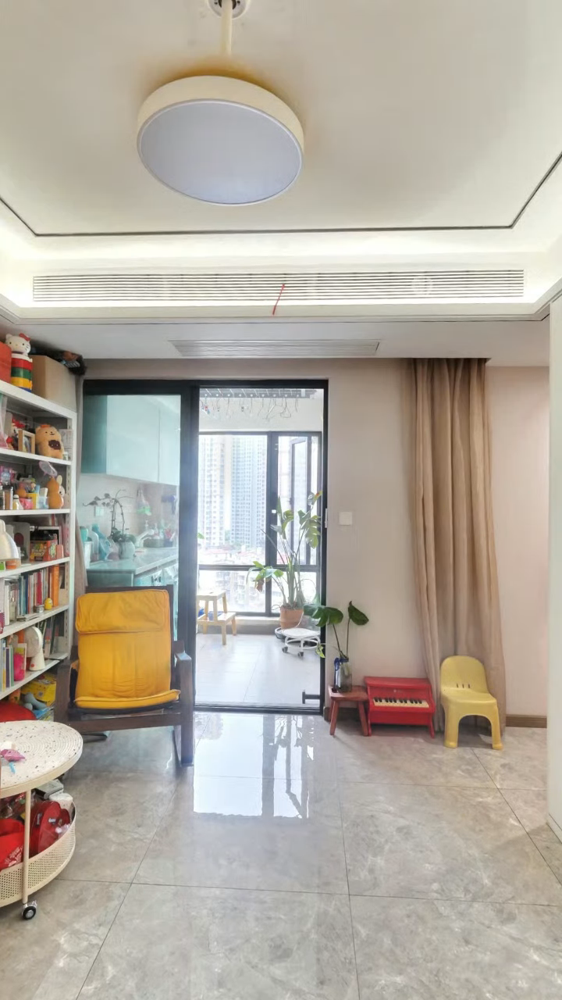
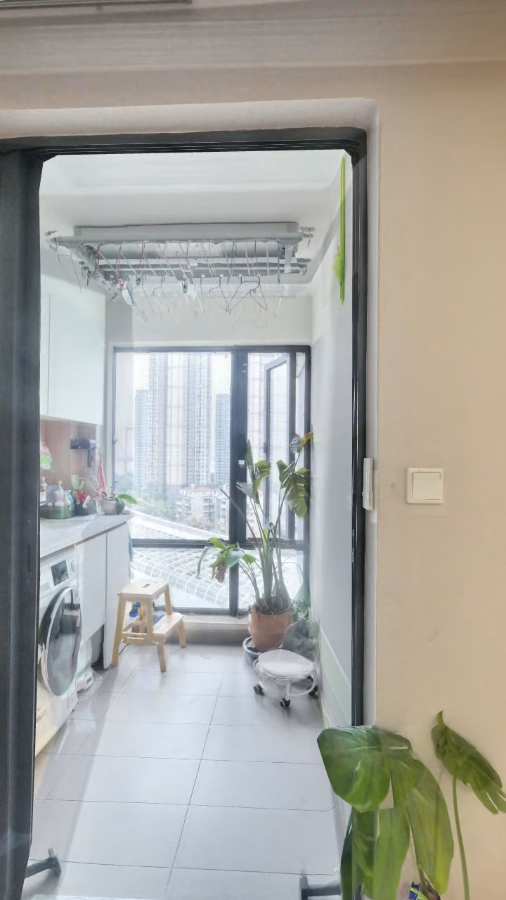
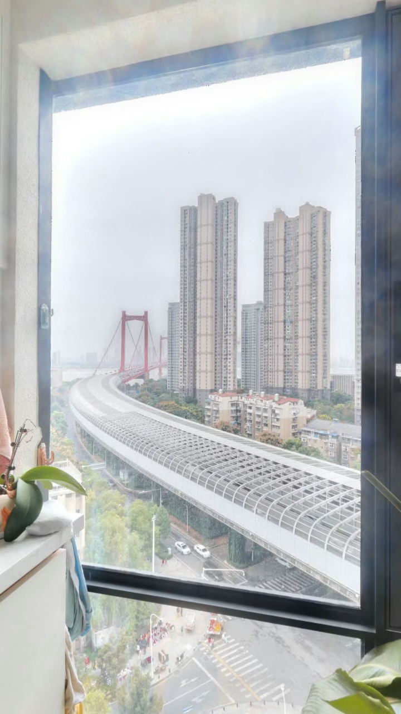
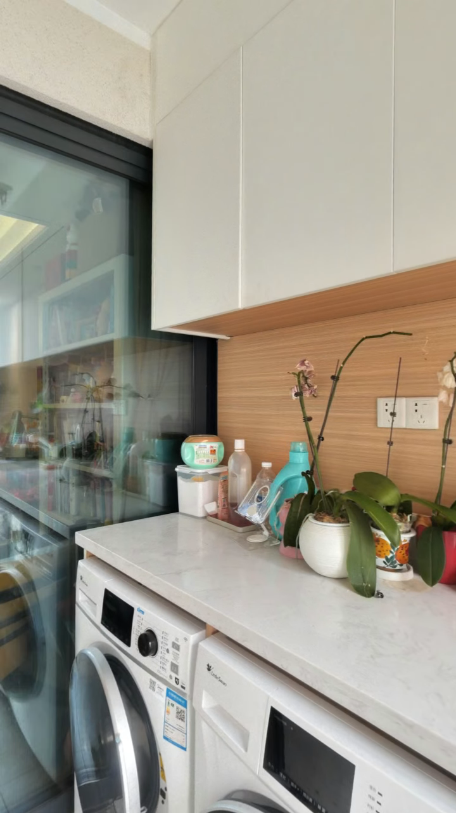
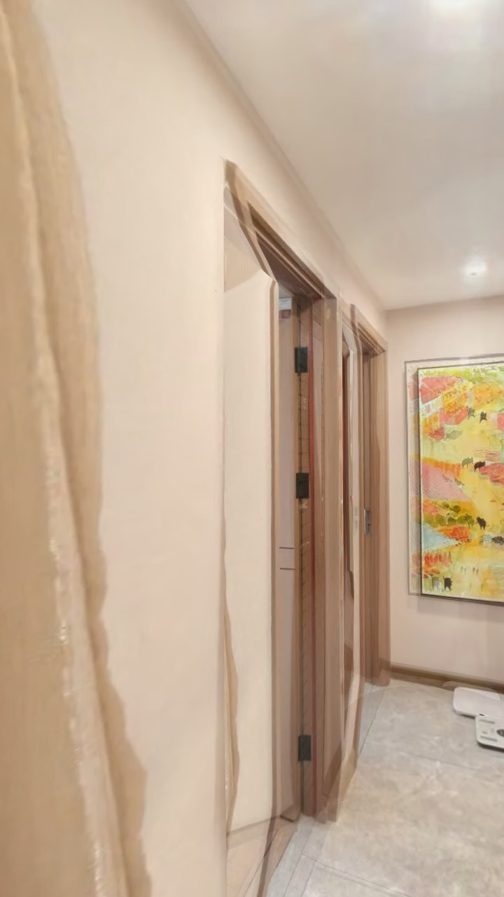
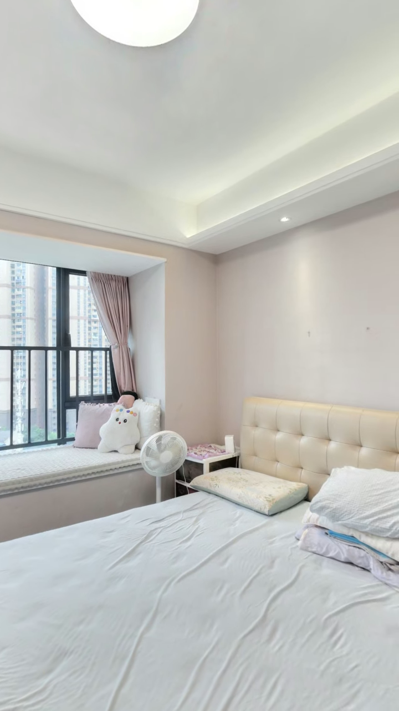
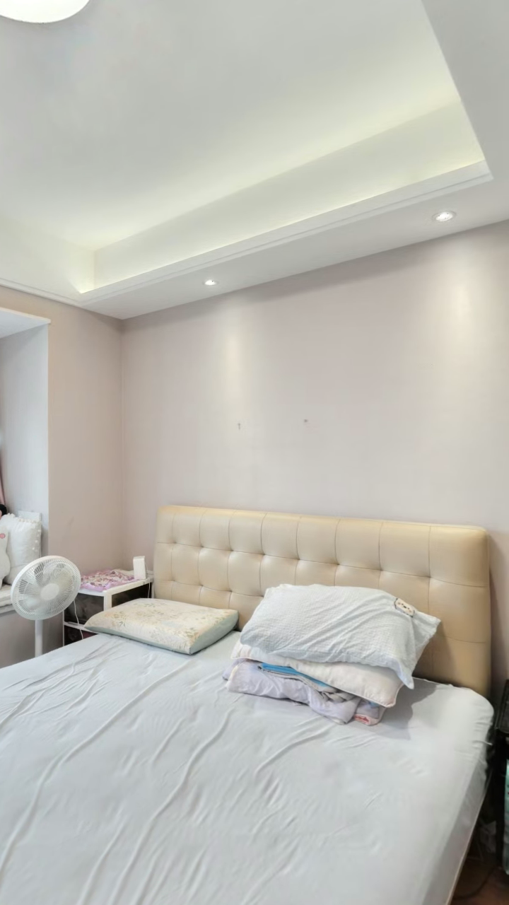

# 招商愉樾 · v15推进加快 · 同版完整图文剧本 · v15 · 25.33秒 · 根据用户参考片调整推进节奏

状态：POST_REVISION_PENDING_ACCEPTANCE；方案板与本正文由同一record.json生成。

## 一、完整方案板

## 二、详细视频剧本

## 户型运镜路线图（仅用于剧本审核）

沿用已拍完整连续路线；仅调整速度，按v15实际时码展示。虚线表示重复经过，不是倒退或切镜；路线图只用于审核。

## 制作范围

- 房源：104121501123/jZwe3qrALx0M7dBG；方法：panorama_sdk_navigation；范围：model_only。
- 时长：25.333333秒；配置：{"renderer": "Five6.6.20 / Three r117", "width": 720, "height": 1280, "dpr": 1, "fov_axis": "vertical", "fov_deg": 85.57, "near": 0.08, "far": 800}。
- opening：0–2.85秒：户型浮层与标题；约1.8秒开始向阳台移动，浮层随后淡出。
- ending：22.23–25.33秒：同一卧室背景，房况提示后留言。
- bgm：用户提供郭腾腾《喜剧之王（剪辑版）》OGG；取0–25.33秒，旁白让位与首尾淡化。
- route：3→4→5→6→5→4→14→15
- facts_and_rights：归档建面88.73㎡、3室2厅；本片展示客厅、阳台真实窗景和卧室B，不拍卫生间。完整户型路线板仅用于剧本审核，不进入成片；不授权发布。
- 连续性与后期边界：{"single_take_required": true, "allow_cuts": false, "allow_remove_intervals": false, "allow_speed_changes": true}；绑定同一完整原件，变速不授予切镜。
- 覆盖：客餐厅、阳台与真实窗景、卧室B
- 字幕：verbatim_voiceover / burned_in。
- 授权范围：["voiceover", "opening", "ending", "subtitles", "bgm", "encode", "qc"]。
- 未授权：["倒退离开阳台", "硬切/删除中间段/拼不同原件", "拍摄卫生间", "穿窗或合成外景", "公开发布或新增未批准费用"]。
- 原户型图：../floorplan.png

## 调整与待审核项

- 片头更早开始移动：静止片头由3.01秒压到1.80秒；户型浮层可覆盖开始推进的画面，2.85秒退出。
- 主要推进提速：客厅至阳台6.30→4.50秒，回程8.28→6.10秒；两段分别约快40%和36%，相对于v14章节平均速度。
- 速度平滑衔接：用正导数连续时间映射覆盖完整原件，不硬切、不删中间段；展示外景、卧室门口扫视保留观看时间。
- 声音与剧本同步：25.33秒新成片同步配音落位、真实词级字幕、指定BGM、首尾及完整方案板；没有把旧字幕或音乐整轨加速。
- 限制：沿用同一30.498秒原件，保持全部源时间区间；SDK过渡重影、门框变形与转向柜台仍在。后期变速不冒充修复源画质；最终听感和节奏待用户验收。
- 事实口径：归档建面88.73㎡ · 3室2厅；本片只展示客厅、阳台窗景、卧室B，不拍卫生间。

## S01｜户型与客厅开场

- 时码：0.0–1.8秒。
- 布局：opening_composite；标题角色：opening。
- 动作图示：static / P3 · 室内背景＋户型浮层。
- action：0–2.85秒：户型浮层与标题；约1.8秒开始向阳台移动，浮层随后淡出。
- focus：客厅与户型关系
- text：招商愉樾，三室两厅。
- music：用户提供郭腾腾《喜剧之王（剪辑版）》OGG；取0–25.33秒，旁白让位与首尾淡化。
- risk：源SDK跨点重影及门框变形仍保留，变速不消除投影问题；音色及房源名待人工核听。
- 黄标：。
- headline_lines：["招商愉樾", "建面88.73㎡ · 3室2厅"]

## S02｜客厅走向阳台

- 时码：1.8–6.3秒。
- 布局：source_reference；标题角色：chapter。
- 动作图示：travel / P3 → P4 → P5 · 正向推进。
- action：客厅→阳台保持连续正向推进；本章4.50秒，比v14的6.30秒更快。
- focus：客厅、阳台门洞与通道
- text：沿着客厅，走向相连的阳台。
- music：用户提供郭腾腾《喜剧之王（剪辑版）》OGG；取0–25.33秒，旁白让位与首尾淡化。
- risk：源SDK跨点重影及门框变形仍保留，变速不消除投影问题；音色及房源名待人工核听。
- 黄标：。

## S03｜窗边看真实外景

- 时码：6.3–9.5秒。
- 布局：source_reference；标题角色：chapter。
- 动作图示：travel / P5 → P6 · 窗边向外看。
- action：P5→P6到室内窗边，展示真实可见楼宇与道路，不穿窗、不补外景；停留段可适度加速。
- focus：室内窗框与真实窗外景象
- text：到窗边，看看真实外景。
- music：用户提供郭腾腾《喜剧之王（剪辑版）》OGG；取0–25.33秒，旁白让位与首尾淡化。
- risk：源SDK跨点重影及门框变形仍保留，变速不消除投影问题；音色及房源名待人工核听。
- 黄标：。

## S04｜先转身，面向室内

- 时码：9.5–12.128秒。
- 布局：source_reference；标题角色：chapter。
- 动作图示：pan / P6原地转向 · 先对准室内。
- action：保持P6位置，连续转向客厅门洞；转向完成、视线对准前进方向后才移动。转向不在柜面停住，不边看窗外边退行。
- focus：窗边→室内门洞的方向转换
- text：转过身，回到室内。
- music：用户提供郭腾腾《喜剧之王（剪辑版）》OGG；取0–25.33秒，旁白让位与首尾淡化。
- risk：源SDK跨点重影及门框变形仍保留，变速不消除投影问题；音色及房源名待人工核听。转向仍经过生活阳台柜台。
- 黄标：。

## S05｜正向回到卧室门口

- 时码：12.128–18.228秒。
- 布局：source_reference；标题角色：chapter。
- 动作图示：travel / 面向前进方向 · P6→P5→P4→P14→P15。
- action：原地转向后正向回客厅→卧室B门口；本章6.10秒，比v14的8.28秒更快。
- focus：客厅门洞、通道与卧室B入口
- text：沿着室内通道，来到卧室B门口。
- music：用户提供郭腾腾《喜剧之王（剪辑版）》OGG；取0–25.33秒，旁白让位与首尾淡化。
- risk：源SDK跨点重影及门框变形仍保留，变速不消除投影问题；音色及房源名待人工核听。
- 黄标：。

## S06｜门口扫视床与窗

- 时码：18.228–22.228秒。
- 布局：source_reference；标题角色：chapter。
- 动作图示：pan / P15定点 · 窗边 → 床铺。
- action：固定P15门口，不进入P16；从窗边缓慢扫向床铺，保留空间关系；此段保持自然原速。
- focus：卧室B窗边、床铺与房间关系
- text：站在门口，看看床铺与窗边。
- music：用户提供郭腾腾《喜剧之王（剪辑版）》OGG；取0–25.33秒，旁白让位与首尾淡化。
- risk：源SDK跨点重影及门框变形仍保留，变速不消除投影问题；音色及房源名待人工核听。
- 黄标：。

## S07｜卧室室内收束

- 时码：22.228–25.333333秒。
- 布局：ending_composite；标题角色：ending。
- 动作图示：static / 同镜头室内背景 · 轻收束。
- action：22.23–25.33秒：同一卧室背景，房况提示后留言。
- focus：室内背景与清晰留言入口
- text：房况以现场为准，欢迎留言。
- music：用户提供郭腾腾《喜剧之王（剪辑版）》OGG；取0–25.33秒，旁白让位与首尾淡化。
- risk：源SDK跨点重影及门框变形仍保留，变速不消除投影问题；音色及房源名待人工核听。
- 黄标：。
- cta："欢迎留言"
- disclaimer："房况以现场为准"

## 来源与审核边界

- 真实源参考不等于成片；动作图示不证明真实路径；首尾预览是排版设计。
- 本正文、方案板、图源与实际回读绑定后才能提交一次整包审核。机器检查不代替目视和用户接受。
