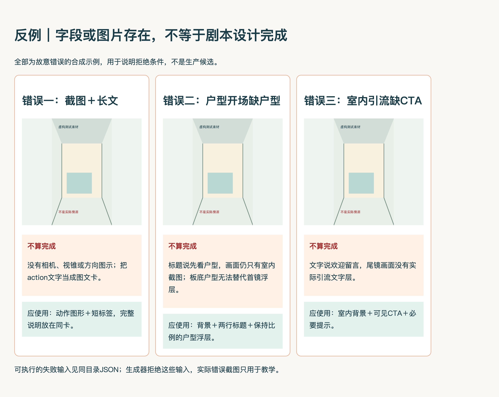

# 正反示例

所有图片都是带标识的合成测试素材，不是真实房源，不提供采集授权。

## 正例：同一内容生成方案板与正文


输入为[valid.json](valid.json)；可放大[方案板图源](positive/storyboard.html)和阅读[详细正文](positive/plan.md)。首尾、完整口播和动作均读取同一record；正例默认DRAFT，不冒充生产批准。

## 反例与无CTA变体




| 反例输入 | 为什么不算完成 | 应有结果 |
|---|---|---|
| [missing-motion.json](missing-motion.json) | 只有截图＋action长文，没有动作图示数据 | 输入校验拒绝，无输出目录 |
| [opening-without-floorplan.json](opening-without-floorplan.json) | 户型开场角色退化为室内源截图，下方户型不能替代浮层 | 角色与预览不一致，拒绝 |
| [missing-ending-cta.json](missing-ending-cta.json) | 不需要引流的室内收束变体 | 允许；不是通用反例 |
| [summary-subtitles.json](summary-subtitles.json) | 声明完整逐字字幕，却另写摘要替代口播 | 拒绝 |

图中尾镜反例只针对已声明需要引流却未实际绘出的情形。没有引流需求不要求CTA。

截图＋长文不是方案板；首镜写了户型但没实际画出户型也不是首镜预览。以上判断同时体现在输入约束、生成器和实际成图检查，不只靠说明文字。

以下是完整仓库的维护命令，需在仓库根目录运行；独立安装的Skill不包含仓库tools，不能把此命令当作包内入口。独立包可直接用scripts/build_script_package.py生成示例，tests保留相应检查。

完整仓库执行正例和反例：

```bash
python3 tools/verify_design_system.py --evidence-out /path/to/verification.json
```

反例JSON只记录相对valid.json的最小差异，避免维护五份重复剧本；验收程序在临时目录中展开差异，再运行真实生成命令。程序运行真实生成命令、核两种输出内容和失败退出状态；UI部分需另在浏览器核图片、动作、首尾图层、溢出并导出PNG。脚本不伪造UI验证。

## 设计系统1.1完整路线板回归

上述valid.json为1.0历史兼容示例。新剧本使用1.1，必须提供review_route及独立完整路线板；可运行tests/test_route_board.py和tests/test_document_review.py验证同点多章、缺路线/缺章、时码与路径漂移、正文遗漏和子目录图片引用。合成回归不替代当前房源成图检查。
