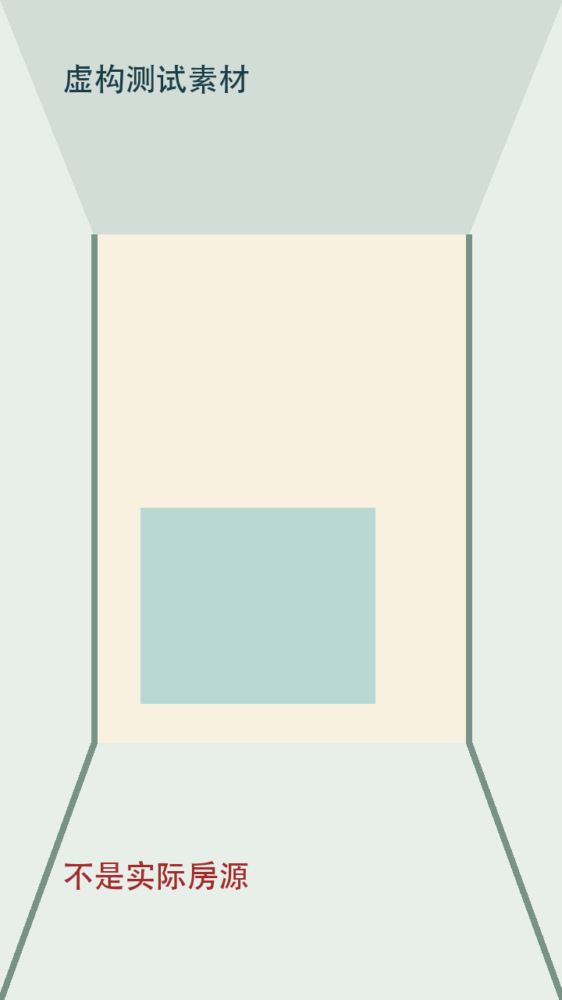

# 设计系统 v1.0｜虚构剧本示例 · DS1.0-fixture

状态：DRAFT；方案板与本正文由同一record.json生成。

## 制作范围

- 房源：SYNTHETIC-FIXTURE；方法：fixture-only；范围：synthetic。
- 时长：12秒；配置：{"width": 720, "height": 1280}。
- opening：虚构室内背景＋测试户型浮层＋两行标题
- ending：虚构室内背景＋欢迎留言CTA＋测试免责声明
- bgm：无音频，本例仅验证版式
- route：合成测试叙事顺序，不是现实路线
- facts_and_rights：全部为合成测试素材，不得当作真实房源
- 覆盖：户型开场、横向观察、连续前进
- 字幕：verbatim_voiceover / burned_in。
- 授权范围：[]。
- 未授权：["capture", "publish", "paid_service"]。
- 原户型图：../floorplan.png

## 调整与待审核项

- 图像用途分开：真实源参考、动作图示、成片布局预览各自标注。
- 一份数据，两种输出：口播、动作及首尾文案只维护一次，同时生成方案板和详细正文。
- 限制：全部素材为虚构。机器校验通过不表示用户接受，也不授权采集。
- 事实口径：合成测试户型，不含真实面积或房源事实

## S01｜户型开场

- 时码：0–4秒。
- 布局：opening_composite；标题角色：opening。
- 动作图示：static / 静态锚点。
- action：静态锚点；图示只表达拍法
- focus：观察图文对应关系
- text：本图为虚构验证示例。
- music：未声明
- risk：合成素材不能用于房源生产
- 黄标：测试。
- headline_lines：["虚构示例房源", "示例户型 · 非真实事实"]

## S02｜公共区横扫

- 时码：4–8秒。
- 布局：source_reference；标题角色：chapter。
- 动作图示：static / 静态锚点 → fov / 短FOV呼吸。
- action：先静态建立观察，再作短FOV变化；示意不证明实测路径
- focus：观察图文对应关系
- text：本图为虚构验证示例。
- music：未声明
- risk：组合动作仅为设计示例，实际素材可用性待审
- 黄标：测试。

## S03｜室内引流

- 时码：8–12秒。
- 布局：ending_composite；标题角色：ending。
- 动作图示：travel / 相机前进。
- action：相机前进；图示只表达拍法
- focus：观察图文对应关系
- text：本图为虚构验证示例。
- music：未声明
- risk：合成素材不能用于房源生产
- 黄标：测试。
- cta："欢迎留言了解更多"
- disclaimer："虚构设计示例，不是实际房源"

## 来源与审核边界

- 真实源参考不等于成片；动作图示不证明真实路径；首尾预览是排版设计。
- 本正文、方案板、图源与实际回读绑定后才能提交一次整包审核。机器检查不代替目视和用户接受。
