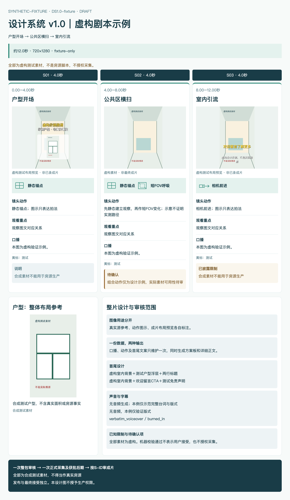

# 房产图文剧本设计系统 v1.0

这是设计与生成的唯一规范入口。生产授权、一次采集与来源证据仍由[图文提交协议](../references/illustrated-script.md)约束。设计系统不会启动拍摄。

## 信息层次




| 区域 | 用户要回答的问题 | 组件 |
|---|---|---|
| 顶部 | 整片讲什么，覆盖顺序与时长是什么 | 名称、版本、状态、叙事顺序、制作概况 |
| 中部 | 每章看什么、怎么拍、说什么 | 横向章节卡；较多章节换行并保持S-ID顺序 |
| 下部 | 户型依据是什么，方案变了什么，哪些待确认 | 原户型、变化说明、首尾/声音合同、限制 |
| 页尾 | 本次审核覆盖什么 | 一次整包审核范围；用户接受和发布独立 |

卡片内部固定顺序：时码/角色标题 → 图像预览 → 图像用途标注 → 动作图示与短标签 → 动作说明 → 观看重点 → 口播 → 黄标 → 风险。标题来自visual.title，不从覆盖空间清单推测。

## 视觉样式

数值以[tokens.json](tokens.json)为准，[styles.css](styles.css)消费同一组变量。规范描述用途，不再抄一套数值。

- 深青用于标题和章节条；绿色用于动作方法；琥珀色用于限制/待确认；正文与说明有清楚层次。状态始终有文字，不能只靠颜色。
- 卡片等列宽、内容自然增高；预览区固定高度，原图contain保持比例。章节数不固定；按最小可读卡宽自动分行，不将九卡缩成接触表。
- 首尾设计预览采用9:16画框，标题、户型卡和CTA各有独立层；户型保比例、不裁墙线。视频实际位置仍以[首尾合同](../references/opening-ending-layout.md)及最终编码画布核验。
- 源图与设计预览可以同卡或通过附文索引对照；首尾必须展示设计预览。HTML可放大，另导出整张PNG及必要局部图。

## 三类图像语义

| 类型 | 能说明什么 | 呈现要求 |
|---|---|---|
| source_reference | 当前素材和取景参考 | 真实来源/SHA或明确的合成测试来源；不能称成片 |
| motion diagram | 计划如何运动 | 相机/视锥/方向/FOV图形＋短标签；不作现实路径证明 |
| opening/ending_composite | 计划中的画面层次 | 将源背景与标题/户型或CTA实际合成；标为布局预览，非已录成片 |

首镜“先看户型”必须能在预览中看到户型；尾镜引流必须能看到明确CTA。下部原户型资料不能替代首镜户型浮层。每一处未核证事实保持待确认，不为补齐设计猜数值。

## 可复用组件

实现位于[scripts/storyboard](../scripts/storyboard)。外部调用只需标准record与图像来源，不需要复制HTML。

- chapter_card：叙事标题与字段同卡；S-ID连接正文、图卡与验收意见。
- motion_component：static静态、pan横扫、travel前进、orbit回转、fov视场变化；motion.steps可顺序组合，例如静态锚点→短FOV呼吸。
- preview：真实源参考、opening_composite背景/两标题/户型浮层、ending_composite室内背景/CTA/免责声明。
- risk_tag：info说明、limitation已披露限制、pending待确认。标签不自动表示用户已接受或房况已核证。

## 标准剧本数据

唯一内容源沿用record.json，格式仍为vr-production-plan/v3；增加design_system标识v1.0，不另建一套平行台本。结构见[schema.json](schema.json)，可运行样例见[examples/valid.json](examples/valid.json)。运行时语义校验由model.py完成；JSON Schema用于编辑器及外部形状校验，不宣称当前运行环境执行了通用JSON Schema引擎。

- plan/scope：版本、来源、覆盖、时长、成像/声音/字幕与制作范围。
- assets：图片路径、真实/合成来源及SHA。组件核身份与字节，不能证明房源事实。
- segments：时间、完整口播、动作、主体、限制、highlights；visual只存呈现角色与方法，不复制口播。
- visual.role/title/layout：opening/chapter/ending、叙事标题、对应预览。首尾角色与布局相符。
- visual.motion：单kind/label，或steps有序数组。图形由组件绘制，不接受只有action文字的替代。
- visual.headline_lines/cta/disclaimer：首尾叠加内容，必须来自同版获审事实/文案。
- board_content.changes：本次实际调整；不由生成器编造“修正了什么”。

命令：

```bash
python3 skills/vr-production-gates/scripts/build_script_package.py \
  --record /private/version/record.json --floorplan floorplan.png \
  --output-dir /private/version/generated
```

生成storyboard.html、plan.md及generation.json，全部来自同一份record。输出目录须不存在；输入缺字段/源漂移先失败，不覆盖旧包。generation回执绑定输入与两种输出摘要，默认visual_review=PENDING、capture_authorized=false。浏览器导出的overview.png与实际回读通过后，另按现有协议绑定提交；生成成功不等于批准。

旧build_storyboard.py命令仍可生成仅HTML；它与新命令共用组件。已有v2/v3历史记录不静默迁移批准，新增设计字段需新版本审核。

## 正反示例与完成判据

[示例索引](examples/README.md)给出成功样例及可执行失败变体。完整交付必须同时有：

1. 同版标准数据、整张方案板、详细正文；两种输出S-ID/口播/动作/首尾一致。
2. 动作图示可见且与短标签对应；首镜三层和尾镜CTA可见。
3. 来源图片全部加载；章节顺序正确；卡片/首尾文字无溢出、无不可读缩小。
4. 真实浏览器渲染＋导出PNG目视；范围、技术、用户接受分开记录。

“字段齐全”“文件存在”“SHA通过”只证明相应机器条件。实际参考结构和图文对应需要目视；用户接受由用户决定。
