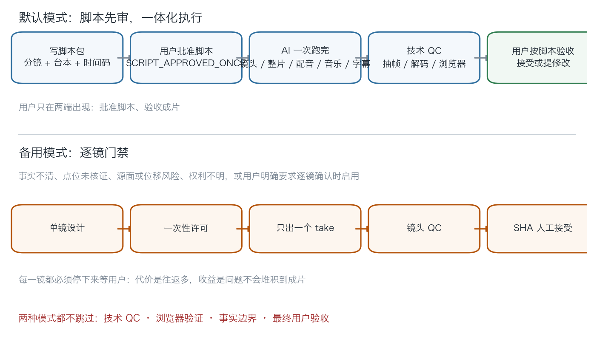
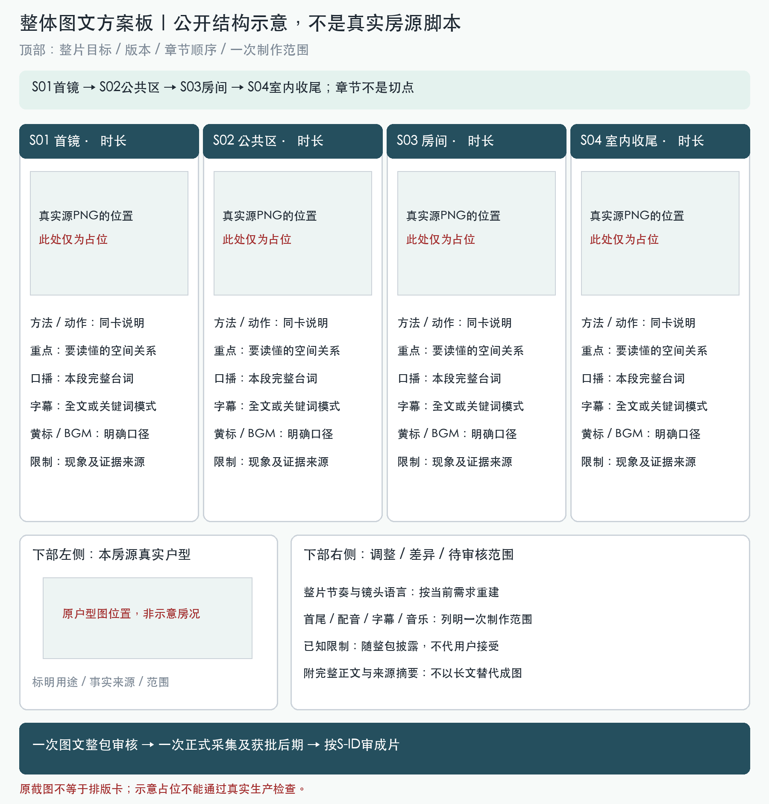
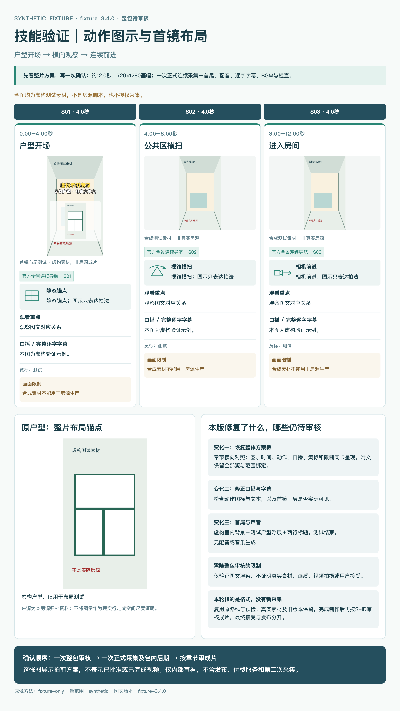
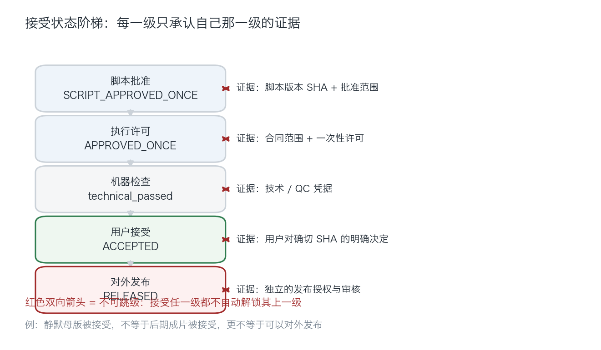

# 示例 · 一次审核后的完整制作

> 仅抽象示意，不含真实房源图或标识；不是能用来批准拍摄的图文脚本。真实源PNG只能在私有项目替换。

## 默认节奏与逐镜例外

事实/权利不清时集中澄清并阻塞未决范围，不自动切逐镜。用户明确要求每镜确认才用例外节奏；新任务不套历史逐镜往返。先规划完整候选路线，再有限实测，不能把“已设计”当“已通过”。

## 图文脚本是什么形状

这张图只演示当前整体方案板格式：顶部整片说明，中部横向章节图文卡，下部户型/调整/待审范围。原截图＋外置文字不算排版卡。实际脚本每卡都必须嵌**本房源真实源PNG**，总览图和正文同版；结构占位图不能通过生产检查。参考截图的旧横扫、硬切或户型图收尾不能覆盖当前要求的一镜到底、推进式、首户型/尾室内。

| 可审部分 | 内容与判据 |
|---|---|
| 总体图 | 覆盖/顺序、路线、介质/验收范围、首尾、总时长；箭头不当测绘 |
| S-ID图卡 | 真实源PNG/SHA、起止时间、推进动作、主体/关系、风险及证据 |
| 完整台本 | 原文/事实来源；或明确无口播，不用标题卡代替口播 |
| 字幕 | 全文/卖点模式与烧录/可选轨独立声明，白黄/黑描边/无底框 |
| 首尾/声音 | 首镜户型图、连续室内背景、室内尾镜/获准CTA、素材库BGM授权池 |
| 范围与审批 | 采集及列明后期/编码/QC；正文/PNG/输入/范围SHA及实际展示/批准事件 |

详见 [图文协议](../illustrated-script.md)、[脚本模板](../illustrated-script-template.md) 与 [记录模板](../freeze-record-template.json)。

## 动作图示与首镜布局

此图全部为合成测试素材，不是房源脚本。它验证图像用途：源参考、动作图示、首镜布局预览分别标注；三者不能互相替代。后两卡只示范源参考与动作符号，不是生产授权。

## 例子中的执行顺序

1. 先读[用户视觉基准](../visual-acceptance.md)，再预算内核当前方法/源/路线完整动态证据，不用旧PASS替代。过渡现象符合用户参考则披露，不为AI零伪影要求追加探索；超范围或未决集中回审，不随机重跑全屋。
2. 实际展示完整图文内容、正文SHA、BUNDLE_SHA256。仅报路径或纯文字技术表不算提交，模板缺图保持BLOCKED。
3. 一次整包批准；入口核动态证据/用户标准与有效视觉结果（PASS或有依据的PASS_WITH_LIMITATIONS），退出0预留新目录以防覆盖/冲突，不设隐含采集次数。带限制并非新审批层，图示/结构检查不自动认证画质。
4. AI自主首尾、获批配音/素材库BGM、字幕、混音、导出/QC；不等母版人审，不再逐项索权。
5. 核视觉/连续性、编码/全解码、首中尾字形与结构、音轨实听、确切文件浏览器完整播放。
6. 交最终视频、S-ID/实际时码对照、最终SHA、QC与限制；用户按脚本审片。

## 三类结果不要合并

技术PASS不是用户接受，用户接受最终SHA不是允许商业发布。脚本批准已覆盖的后期不需新许可；它没有覆盖的新事实/CTA、付费或发布仍不执行。

## 退回与修改

- 同母版范围内字幕位置/字形、音乐电平、编码问题 → 独立后期版本，保留旧件，不算第二次拍摄。
- 事实、覆盖/路线、来源/权利、CTA、时长、成本变化 → 新脚本版本回审；不能刷新SHA沿用旧展示。
- 正式采集失败或画面录入源伪影 → 保留原件，不自动重拍；用户明确不拍第二次时，不用新take名绕过限制。

静默母版只有中间态，要求字幕/BGM而未做后期时不能交为完整成片。现有源伪影也不会因更新规则而被消除。
