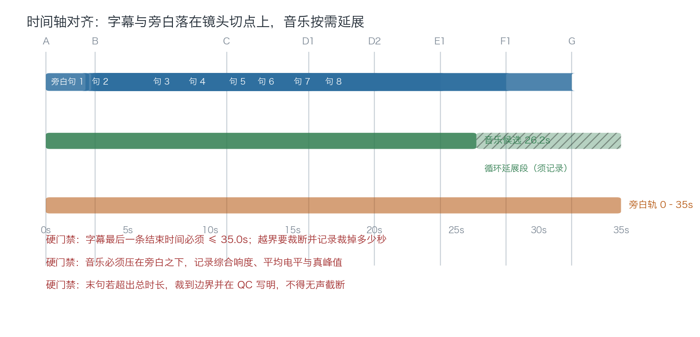
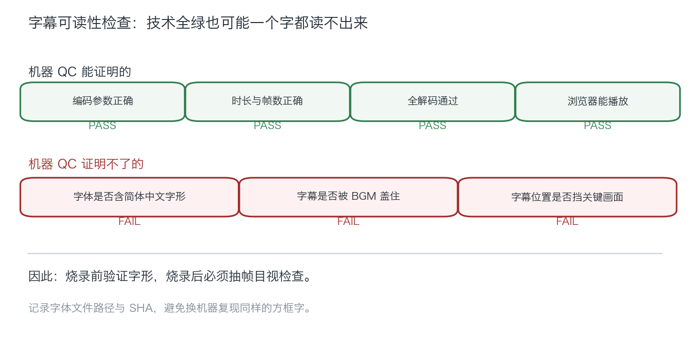

# 示例 · 后期成片的时间轴与可读性

> 图文笔记。用抽象时间轴与判据说明，不含真实音频波形、房源画面或标识。

## 时间轴怎么对齐

三条硬约束：

1. 字幕与旁白按**镜头切点**落位，不按音频自身长度落位。
2. 字幕最后一条结束时间必须 ≤ 画面总时长；越界要裁断并记录裁掉多少秒。
3. 音乐按需延展，但延展方式、循环次数与淡出参数必须写进技术检查。

## 配音比画面短怎么办

真实情况很常见：整段配音 25 秒，画面 35 秒。不要整体变速硬压，也不要让字幕跟着音频跑。

正确做法：

1. 用字幕时间戳把整段拆成单句。
2. 按镜头起点逐句延时对齐。
3. 混合成完整时间轴，输出为**新资产**，绑定源音频 SHA。
4. 原始 TTS 资产不覆盖，SHA 证据链不断。

代价是句间会有呼吸空隙。对信息类房产视频来说，这比压缩语速更自然。

## 音乐短于成片怎么办

生成式音乐接口常常没有时长参数，实测产出过 16.65 秒和 26.20 秒的候选。

- **方向先于生成**：先确认音乐方向再调用，否则生成多少次都白费。
- 循环延展 + 尾部淡出可以接受，但必须记录。
- 候选与最终入轨分开：候选记生成器、参数、格式、采样率、码率、SHA、客观响度。
- 响度以旁白优先；出现真峰值超满刻度时入轨前留 2–3 dB 余量。

## 字幕为什么"技术全绿却不能用"

真实退回案例：35 秒、帧数正确、全解码通过、浏览器播放正常——但抽帧一看，字幕全是方框。
原因是烧录字体不含简体中文字形，而脚本里写的是一个没有汉字的通用字体名。

**可解码 ≠ 可阅读。** 因此：

- 烧录前用实际字体文件验证目标语言字形存在，不要假设字体名可用。
- 烧录后必须抽帧目视检查，不能只信自动 QC。
- 字体文件路径与 SHA 记进 QC，避免换机器复现同样的问题。

## 后期交付清单

- [ ] 输入母版 SHA 与已接受记录一致
- [ ] 旁白资产 SHA、provider/model/voice/语言已记录
- [ ] 音乐资产 SHA、来源与许可已记录
- [ ] 字幕末条不越界；字体路径与 SHA 已记录
- [ ] 混音：旁白可辨、音乐在旁白之下、无削波
- [ ] 编码、全解码、抽帧、浏览器播放全部通过
- [ ] 成片新 SHA 已提交用户验收
