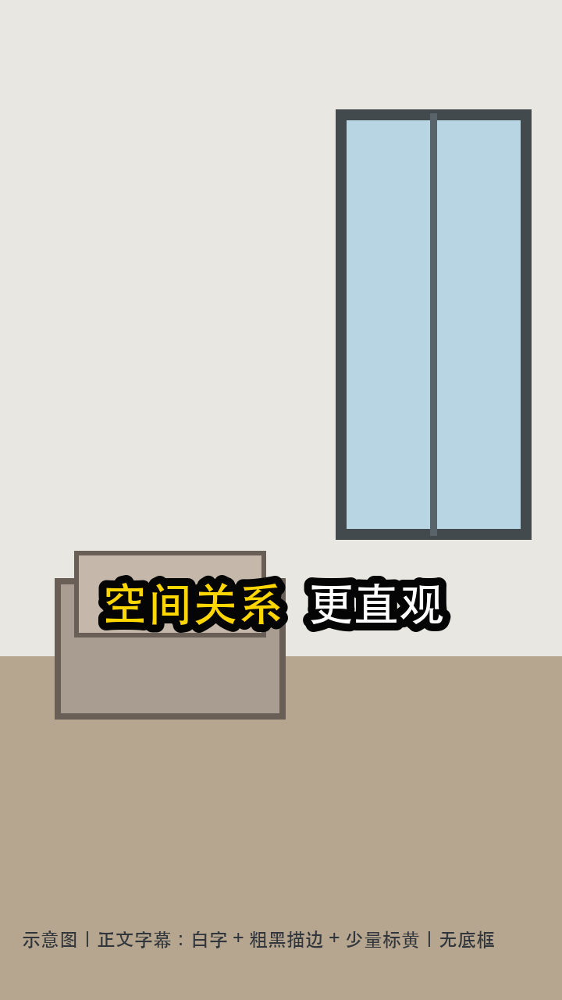

# 字幕样式规范：参考片观察与覆盖模式

> 用于房产介绍竖屏视频的正文字幕。制作前必须区分字幕的**内容覆盖模式**与**视觉样式**：参考片展示的是卖点压缩字幕，不代表用户要求完整口播字幕时也可以省略口播文字。标题卡/户型图信息卡另按自己的层级排版。以下是对本地两条参考视频抽帧观察后的风格总结，不把其房源事实、台词或素材复制进本 Skill。

## 观察结论

两条参考片的正文字幕共同特征：

- **单行、水平居中**，位于画面中部偏下但仍高于常见平台底部 UI；抽样帧的字幕字形包围框中心约在 `0.614–0.623H`。
- **白色粗黑体 + 粗黑描边**，在浅墙、窗景和复杂背景上仍可辨认；无实色底框。
- 每行只把 **1–2 个事实锚点标黄**（数字、空间名、方向或关系词），其余保持白色；黄色只负责视觉强调，不改变证据等级。
- 参考片采用**卖点关键词压缩**：配音承担口语叙述，字幕负责一眼可扫的信息锚点。这是样本的内容模式，不是所有项目的强制口播覆盖规则。
- 通常每行组织为两个短语/信息单元，表达“事实/空间 + 关系或结论”；纯形容词不单独成卖点。
- 标题卡是例外：可用两行层级（标题/项目名与事实信息分行），不要套用正文字幕字号与位置。

## 内容与交付模式（脚本合同必须明确）

- `editorial_keywords`：卖点关键词压缩模式。允许字幕概括口播，但只能表达有事实来源支持的锚点；参考视频观察对应此模式。
- `verbatim_voiceover`：完整口播字幕模式。字幕必须覆盖成片中全部口播文字，不得摘要、删句或把整句换成场景标签；长句可按自然停顿拆成连续的单行 cue，但不得漏词或改写。
- `subtitle_delivery`：记录为 `burned_in`（烧录上屏）、`selectable_track`（可开关字幕轨/配套字幕文件）或 `both`。用户明确要求“完整口播字幕直接上屏”时，采用 `verbatim_voiceover` + `burned_in`。
- 视觉样式与内容模式互相独立。若请求没有说明是否要完整覆盖口播，不能仅凭参考片样式自行决定；在脚本批准前先澄清。

## 首镜、正文、尾镜分层（不能只改正文就声称整片对齐）

首尾结构优化必须同时执行 [首尾镜头结构对齐协议](opening-ending-layout.md)。本轮目标截图优先于历史模板；`reference_match` 不得以获批白底资料卡替代。其首镜大标题/圆角户型浮层参数不套正文字号，尾镜单行 CTA 仍按正文几何验证。

| `layout_role` | 参考视频可见结构 | 制作与验收规则 |
|---|---|---|
| `opening_title` 首镜标题卡 | 室内视频作背景；上方两行大字标题（名称黄、面积/户型白，粗黑描边）；下方独立户型图卡片 | 名称、面积、户型须来自本房源已核验事实并获批准。两行层级与正文单行规则不同；记录背景、标题、户型图三层的位置与比例。户型图卡片的半透明底不等于正文字幕黑底框 |
| `body_caption` 正文 | 室内画面上的单行白/黄粗描边字，约 `0.61H` | 保留已批准覆盖模式；按正文参数及实际手机可读性验证，不用细字体加厚描边冒充粗黑体 |
| `ending_caption` 尾镜 | 示例仍用室内视频背景，单行收束/CTA，关键词黄标；不是白底户型资料卡 | 尾镜背景、CTA 与免责声明属于脚本设计，不因参照片出现就自动授权。可保留获批资料型收束，但须披露与示例差异，不得宣称结构一致 |

完整口播字幕与标题卡是不同文字层。用户要求完整口播时，首段和尾段实际口播必须完整上屏；标题卡的房源信息不能替代口播。若两层同时出现，应分别安排区域和时段，不能重叠遮挡，也不能静默删除口播。

### 资料卡双层排版（仅用户明确批准的资料卡变体）

本节是 `approved_variant` 的兼容规则，不是首尾对齐示例的默认方案。新室内背景浮层结构须重测户型主体 bbox，不继承旧白底资料卡守卫。

- 在静态户型资料卡上，可按批准方案采用上层事实标题（项目名、面积/户型）与下层完整口播。尾镜上层也可按合同留空；标题不得替代口播，两层不得重叠或遮挡户型主体。
- 上层文字来自本房源核验事实，或用户确认后另存登记的新增事实。遵循项目事实合同的版本规则，注明用户确认来源、日期、房源命名空间与适用范围，不改冻结档案。登记事实仍须取得上屏许可；不能顺带用于未授权 CTA。
- 资料卡各层不套正文 `0.59–0.63H` 位置带或 `4.0–4.8%H` 字高带；逐层登记 `layout_role`、背景源、文字来源、含描边包围盒与主体遮挡检查。主体边界由实际卡片测量，不能跨房源照搬像素。
- 本轮 720×1280 案例使用首卡主体 y=399–880、尾卡 y=292–987 的区域守卫；这些仅是该素材的测量值，不是通用规范。
- 标题/口播拆分成多行层级或连续 cue 时，任何行不得以 `，。！？；：、` 开头；标点留在上一行。完整口播仍不漏字。
- 尾镜CTA未列时默认空；留言/约看文案和动作必须明确列入本次完整脚本批准，已列不再另索许可，未列回审。禁止复制参考房源的名称或CTA，免责声明与批准台本一致。
- 参考是室内背景＋留言 CTA、本片是白底/深色资料卡＋免责声明时，manifest 与审看入口必须明写结构未对齐；不能称首尾与参考一致。

### 锚点与未改区域回归

每条 cue 声明中心或顶边锚定、坐标系及包围盒（含描边）；修改脚本后，预检将未获准改动的 cue 几何与指定基准 take 逐像素比对，不能只验证落在安全带内。中心值误当顶边值在本轮造成约 25px 下移，虽仍在安全带内也属越权。

重编码的 x264 码率分配/预测会把改动传播到其他帧，不能要求重编码后未改帧逐位相同。按同帧时间、尺寸与像素格式对齐，使用逐帧 PSNR 等差分量化，记录基准 SHA、比较区域/帧集合、阈值与结果，并辅以几何及目视检查。不能只用全片平均值掩盖局部错位。

本轮案例对正文 cue 帧采用最低 PSNR ≥38dB，错误锚点测得最低20.4dB；改排版 cue 的 <35dB 仅用于观察变化，**不是正确性或必须达到的验收门槛**。这些数值受内容与编码参数影响，后续任务须明确约定，不作为通用质量保证。差分不能替代字形、坐标、内容覆盖与授权核对；音频流复制另以音频包数据验证，不能以视频 PSNR 推断音频未变。

### 修订范围判定

- 仅调整已授权文字的字体、描边、位置、黄白配色、cue分段：同母版独立后期版本，不覆盖、不再次拍摄、不另索拍摄许可。
- 从白底户型卡改为室内视频背景叠户型图、添加名称/面积/户型标题、更换尾镜为室内画面、添加留言/约看 CTA：涉及背景素材、画面结构或事实/CTA 范围，先回脚本审阅，不靠“只修字幕”越权。
- 不复制参考房源的名称、数字、户型图或 CTA；房源事实和可见结构分别核验。
- 若只获准字幕修订，必须把未能对齐的首/尾结构列为差异，不能假定这些差异已获用户接受。

### 参考比对证据

先确认参考视频与目标视频的 SHA、时长、时间点，直接读取视频；分别比对首段、中段、尾段。截图标签并不能证明它是准确的首帧或尾帧。冲突时只读取证，报告当前片与示例各自的来源，不借此生成下一 take。

以最终编码画幅记录字块包围框、含描边字高、左右边距、黄白词分配和层次。不能只报告字体大小数值或全解码 PASS；也不能从像素图猜出精确字族、字号或描边源参数。参照字体形态做并排目视验证，量化值只作起始值。

## 可执行参数（仅正文及采用同版式的尾镜字幕）

| 项目 | 默认值 | 容差/说明 |
|---|---|---|
| 画布 | 竖屏 | 按最终编码尺寸换算像素，不按预览窗口估字号 |
| 正文行数 | 同时显示 1 行 | 超宽时按内容模式处理；完整口播可拆成连续 cue，不得静默摘要或缩成难读小字 |
| 水平位置 | 画面中心 | 字块几何中心对齐画布中心 |
| 垂直位置 | 字块包围框中心 `0.61H` | 试制容差 `0.59–0.63H`；避开主体/关键物体时，只在同一安全带内小幅调整并留截图 |
| 字高 | `4.0–4.8%H` | 含描边视觉面积；以 720×1280 计约 51–61 px |
| 文案长度 | `editorial_keywords` 通常 8–12 个汉字/符号；`verbatim_voiceover` 不设摘要字数上限 | 完整口播需逐字保留；长句拆成连续单行 cue，并保证可读速度与左右安全边距各 ≥5%W |
| 颜色 | 主文白色 `#FFFFFF`；关键词暖黄 `#FFD600` 左右 | 每行最多黄标 1–2 处；不可整行全黄 |
| 描边 | 黑色 `#000000`，圆角/圆头视觉 | 描边宽约字高的 12–20%；复杂/高亮背景取上限 |
| 底框 | 无 | 禁止默认加不透明字幕条/黑色圆角卡片；背景特殊时先用描边与轻微阴影解决 |
| 字体 | 已验证包含简体中文字形的粗黑体 | 记录字族、文件路径与 SHA；禁止只凭字体名称猜字形覆盖 |
| 时间 | 与对应口播及画面节奏同步 | 按最终成片口播落点排时；不得未经校准沿用 TTS 单段音频的局部时间码；不越总时长 |

> 尺寸是起始模板，不是脱离实机验收的保证。最终需在手机尺寸/浏览器实际成片抽帧检查；若安全区、主体遮挡或平台 UI 不合适，按可读性证据调整。

## 文案构造

### `editorial_keywords`：正文卖点

先从已核验事实中选一个锚点，再压缩成“事实/空间 + 关系/结论”。示例为**纯虚构占位**，不可复用为房源事实：

- `餐厅到客厅｜动线更直观`（若画面与资料均支持）
- `主卧与阳台｜关系清楚`（只有房间归属和连通关系核实后才可用）

同一条字幕只表达一个主卖点，避免数字、空间、朝向、情绪 CTA 同屏堆砌。此模式允许不逐字转写口播。

### `verbatim_voiceover`：完整口播

- 文案与最终音轨实际说出的内容逐句对应，不改写、不摘要、不漏掉口播句子。
- 为维持单行版式，长句可以在自然停顿处分成连续 cue；完整内容必须全部出现，不能为了套用 8–12 字长度而改成标签。
- 若语速/时长不足以让完整文字可读，先调整字幕分段或回到脚本审阅；不得静默删减口播内容。

### 关键词标黄

- 每行最多标黄 1–2 个短语，优先数字、空间名、方向、关系词；完整口播也可只强调少量锚点，其余保持白字。
- 必须来自同一份核验事实对象；若字幕里的字段无法在事实来源中定位，不标黄且不能改写成断言。
- 黄色不能让不确定的判断看起来像已证事实。

### 配音关系与交付

`editorial_keywords` 模式下，配音可把字幕扩展成自然口语，但不得引入字幕/事实对象没有的新数字、房间归属、面积、朝向、实时状态或功能承诺。`verbatim_voiceover` 模式则字幕完整对应配音，不做摘要。需要观众可开关字幕时，须生成与最终成片时间轴同步的字幕轨或配套文件；烧录字幕本身不是可开关字幕轨。CTA 若存在，逐字事实审阅并独立授权。

## QC 清单

- [ ] 脚本合同是否声明 `subtitle_content_mode` 与 `subtitle_delivery`？
- [ ] 正文是否单行、居中、未加底框？
- [ ] 字块中心是否在 `0.59–0.63H` 的实测安全范围？
- [ ] 字高是否足以手机阅读，且左右各留 ≥5%W？
- [ ] 每行黄标是否最多 1–2 个且均能回指已核验事实？
- [ ] 字体实际字形是否完整？烧录后抽帧可见、非方框、无缺字？
- [ ] 字幕是否避免盖住门窗、家具/设施等当前镜头的主信息？
- [ ] `verbatim_voiceover` 是否逐句完整覆盖实际口播、无漏词/改写，并按最终混音时间轴同步？`editorial_keywords` 是否明确允许压缩且未冒充逐字字幕？
- [ ] 可开关字幕是否确有字幕轨/配套文件；烧录版是否明确仅为画面字幕？
- [ ] 首镜/正文/尾镜是否分别声明 `layout_role`、背景源、文字来源与授权范围？
- [ ] 是否声明 `reference_match` / `approved_variant`，分别记录首/尾结构通过，而不以技术通过或资料卡获批冒充参考一致？
- [ ] 首镜是否逐项核对背景、标题信息层级、户型图卡片布局；未获准改结构时是否明确保留差异？
- [ ] 尾镜是否核对画面背景、收束文案/CTA、位置与黄白配色；不得自行把资料型免责声明换成留言 CTA？
- [ ] 标题卡是否与正文口播字幕分层，既不重叠也不替代完整口播？
- [ ] 首段、cue 切换点及末段是否抽取实际编码帧，并与同角色参考画面并排目视核对？

拒收条件按模式判断：两种模式都拒收方框/缺字、底框遮挡、时间错位、越界或盖住重要主体；`editorial_keywords` 模式拒收不合事实的压缩；`verbatim_voiceover` 模式拒收仅显示场景标签、漏句或把口播改写成摘要。

此外拒收：首/尾角色混用、标题卡代替口播、未授权添加房源信息或 CTA、改变背景素材却未回脚本批准，或只验正文便宣称首尾与参考结构一致。截图与记录冲突未解决时，不宣称已查明原因。

- 预检还须检查每行行首标点、资料卡主体区域守卫，以及未改 cue 与基准的锚点/包围盒一致性。
- 越权产出立即阻塞，不因全解码通过或 PSNR达标而登记为可交付候选。

## 证据与边界

- 观察对象：两条本地竖屏参考片的抽样帧；原视频不随公开 Skill 仓库分发。
- 视频技术信息与 SHA 使用脱敏别名登记于 `../../../raw/R20261008-subtitle-reference-review.json`。
- 正文字幕中心位置为人工抽帧测量，属于近似值；它不能认证所有平台 UI 安全区，也不能代替目标手机上的可读性审看。
- 真实房源事实、参考片台词、品牌和屏幕截图都不复制进公开示例。
