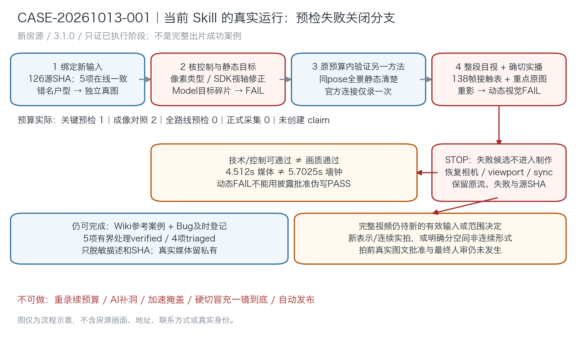

# CASE-20261013-001 · 当前Skill制作新房源视频：预检失败关闭参考

> 记录日期：2026-10-13。Skill `vr-production-gates@3.1.0`。房源脱敏别名 `HOUSE-REDACTED-002`。
> **本页保留3.1.0更严门槛下的执行快照，图及原始观察不改。** 用户随后明确接受基准、规范已升3.2.0：见本节更正，完整视频仍未制作，不能标端到端成功。

## 2026-10-13更正：用户实际接受范围优先

用户事件`de658a6b`以厨房试片SHA `0c08ab62ee3a23437d79657428e2b89cc784ad20f44e695dd0bdd73228855bae`实际情况作接受范围。该已接受片确有Panorama跨点重影，后段同点横扫清楚；不能用AI零伪影理想决定其接受程度。3.2.0[视觉规范](../../skills/vr-production-gates/references/visual-acceptance.md)允许有真实基准/比较/披露的PASS_WITH_LIMITATIONS；本页旧“重影FAIL/必须换源或形式”不再是当前唯一条件。

原图/媒体现象、FAIL及[raw](../../raw/R20261013-case001-precheck.json)保留，不能改写为当时已通过。后续恢复制作先用已保存媒体按已给基准另评，不自动重录/换房/改硬切、不给参考内现象另加缺陷审批；也不未经当前比较直接称全屋PASS/新片已人审。规范错误及回归见[ISSUE015](../issues.md#issue-20261013-015)，最终接受/发布仍独立。

## 实际流程及停在哪一步

用户明确要求使用当前Skill制作视频，同时把流程沉淀Wiki，并及时登记bug；集中确认后选择“本地库另选一套”及“完整新视频：一次采集＋后期”。该范围确认不是未展示脚本的内容批准。

| 阶段 | 实际操作 | 结果与边界 |
|---|---|---|
| 读入/范围 | 读canonical、连续镜头/图文协议、当前状态/风险与既有原件保护边界；另选不同房源 | 不恢复上一房源失败候选，不把旧许可或PASS迁移 |
| 本地初筛 | 8套元数据比较，选紧凑17点有家具的新房源；126文件SHA基线 | 文件存在不证明动态可用；仅一套进入实时核查 |
| 选材纠错 | 名为户型图的JPEG实际是17点接触表；保留原件，独立从同Work取得真正户型图并读回 | ISSUE006仅本案例选材verified，资料库错名原件未改 |
| 身份/控制 | 当前模型+4贴图在线/本地SHA一致；核主相机/SDK、竖屏/投影/视轴；修像素返回类型与目标方向 | ISSUE007/008仅采样控制verified，不证画质 |
| 关键静态预检 | Model厨房原采集点已显挂物、水龙头碎片 | ISSUE009视觉FAIL，停止该方法；loaded/refined/相机坐标不替画面 |
| 同问题第1组 | 同pose仅换成官方真实全景 | 静态目标清楚，不证明移动 |
| 同问题第2组 | 当前官方SDK `fly`完整局部连接仅一次；临时挂起同步并finally恢复 | 控制达到声明容差，动态画面重影FAIL；两组预算用尽，不跑全屋 |
| 原流审看/实播 | 138全部解码帧、4全帧接触表及001/070/138原图；确切原WebM真实点击1x从0到ended | 技术/播放可用不改变动态FAIL，非完整介绍视频或音轨实听 |
| 恢复与问题 | 原URL/相机/viewport/有效view/sync/helper回读；原流/失败报告和源SHA保留 | 已登记9项新问题，5项有界处理verified、4项triaged |
| 图文批准/制作 | 全路线预检0、可执行图文提交0、正式capture claim0、正式采集0 | 不输出伪PASS报告，不拿“继续”代替整包批准；完整视频仍未完成 |

## 可核验结果

脱敏事实记录：[原始观察记录](../../raw/R20261013-case001-precheck.json)。这是私有原始证据的脱敏摘录；真实媒体/源路径与完整JSON留私有，不作为公开可下载附件。

- canonical入口SHA：`8c4a2d5b71750107e5250d68f52e20efa1a4ff69c0d41fe43316adb1db9cefec`。
- 当前静态Model目标：PNG SHA `9dbd8969550f6a6f004fae1c541360bb13787fe2639f577955b2f6b996733321`，画面碎片FAIL。
- 同pose全景：PNG SHA `08d4e59454182db8edaf1aa9ab669dd7d4ba2aea79d39ce7a121cea4aef9f811`，只作静态参考。
- 局部原WebM：SHA `8350fc754f2273c814f0edd24e2d4f2810b545c7fffe30927a0e25deb0852b5e`，2,563,729字节、VP9/720×1280/无音轨；138个VFR帧、PTS0至4.512s，全解码真实返回0。没有H.264转码，不把原流重影归因转码。
- 实际291条RAF相机遥测，无回退，FOV/方向误差0；末端误差 `0.0004757628191646763` **模型单位**，在预声明0.001内，不是现实米制或误差0。浅引用`state.offset`失真字段弃用，不补造旧状态序列。
- 070原图（PTS2.245s）窗框、挂物、水龙头和抹布多层半透明错位，SHA `bf363ce9844d707d8db3c2ca2cc36ad69f03f629f47c50d2e4e1ca74296c33eb`。接触表覆盖138帧不等于138原图全部放大逐张审看。
- 录像墙钟5.7025s、导航调用→回调4.498s，媒体末帧4.512s；不认证计划600ms起尾停留/CFR30，不变速/插帧/延长/重录使指标变绿。
- 原WebM1x完整实播到ended4.512s，wall4525.7ms/136帧回调、media/window error0、waiting/stalled0。质量累积total276/corrupted0/dropped3含初次加载/定位，不称单次精确138帧或零掉帧。
- 浏览器14项恢复核验通过，位置误差约2e-16模型单位在1e-10容差内，其他pose误差0；录制轨道停止。126源文件SHA未变，原片/旧批准/模型/贴图/会话HTML没有改动。

## 过程中问题如何及时登记

问题出现时先保留失败/原样本，再写[Bug台账](../issues.md)，回归实际通过后才更新状态。正常范围澄清、缺批准、门禁正确拒绝不记bug；同因复发更新原ID，不重建问题名延长预算。

| ID | 现象 | 当前处理状态 / 适用范围 |
|---|---|---|
| [006](../issues.md#issue-20261013-006) | 户型文件错名/错类型 | verified：本案例改用正确来源，原资料库未改 |
| [007](../issues.md#issue-20261013-007) | Uint8Array误当ImageData导图失败 | verified：同posePNG转换与实际读回 |
| [008](../issues.md#issue-20261013-008) | 经度视轴符号错误拍到反向房间 | verified：当前主视轴点积与真实厨房读回 |
| [009](../issues.md#issue-20261013-009) | Model静态目标碎片 | triaged：原方法视觉FAIL未修 |
| [010](../issues.md#issue-20261013-010) | 漏result包装且shell继续依赖命令 | verified：有效媒体提取/全解码，原失败保留 |
| [011](../issues.md#issue-20261013-011) | 官方全景移动半透明重影 | triaged：现象留存；旧标准FAIL保留，按顶部用户基准另评 |
| [012](../issues.md#issue-20261013-012) | state.offset浅引用失真 | triaged：弃用该历史字段，不能回补旧时序 |
| [013](../issues.md#issue-20261013-013) | 媒体PTS与墙钟/计划停留不一致 | triaged：保留并披露，无时序修复 |
| [014](../issues.md#issue-20261013-014) | 一次async实播等待超时 | verified：短调用＋真实点击实际ended，仅本次操作范围 |

## 可复用做法与不可外推的部分

1. **文件名只定位，不证内容。** 当前源图实际读回、房源身份和SHA共同绑定；接触表不是户型图，点号标签不是房间认证。
2. **先核实际API/主相机，再看目标。** 像素类型与坐标视轴错误即使位置/FOV守卫正常仍会产生错误证据；原错误样本不能悄悄改名成有效图。
3. **方法证据独立。** 同点全景静态清楚和Model失败不推出官方跨点可用；移动控制/全解码/实播都不能替视觉。
4. **及时登记，而非一律修完。** 选材/采样/导出问题可以在已授权最小范围修；源视觉限制保持triaged，不因为有替代方向关闭。
5. **失败停止仍可交付真实案例。** 先完成恢复/证据/问题和Wiki，不借“完整视频”目标反复探索；也不能把失败关闭参考写成“出片成功”。

本例尚未验证全屋路线、完整图文拍前批准、正式入口capture claim、TTS/BGM/字幕混音、最终成片实播/音轨实听、用户接受或发布。没有触发正式采集门禁，不宣称已验证真实生产入口接入；这里的停止由Skill执行纪律完成。确切门禁结构/SHA拒绝能力另见既有[检查器/回归](../../skills/vr-production-gates/scripts/check_shooting_plan.py)，不以44合成测试替代本片画质。

## 当时提出的继续条件（3.1.0历史，当前以顶部更正为准）

- 同房源新的有效表示/连续实拍输入，仍先做有界验证，不保证新输入必然通过；或
- 用户明确接受**分空间真实全景介绍、明确切点、非一镜到底**，不伪造跨点行走。选择后另绑定方法/覆盖/预算，并提交真实源图文脚本一次批准，再完成一次新正式制作及列明后期。

以上是当时依据更严门槛的建议，不能在用户给定基准后继续强制换源或形式。当前规则修订不自动恢复生产，后续复用媒体按基准比较/正常整包审核；不代签新片接受、重开预算或发布。
