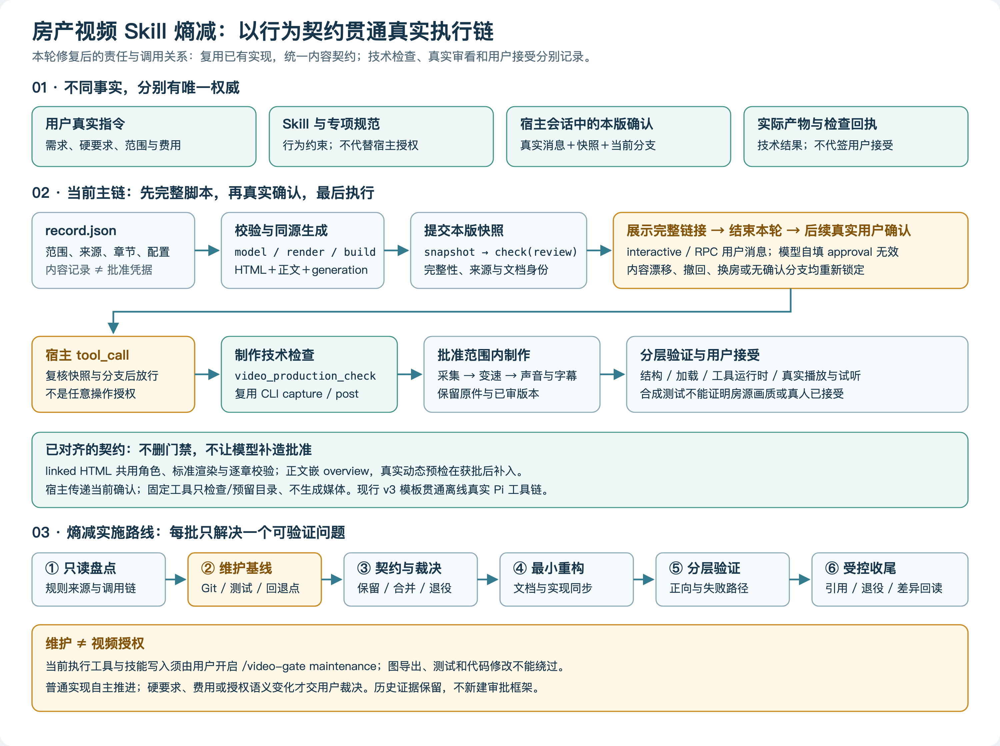

# 房产视频 Skill 熵减实施方案

方案版本：2（实施校准）。对象：`vr-production-gates` 及其直接依赖。实施基线为 `b3aed4239f7c442e485ef9bd9b20e9ef004209e0`（4.12.0）；本轮修订为4.13.0，当前版本仍以Skill入口为准。

本文件固化本次用户确认要启动的熵减方向，是工程方案，不是另一份生产规范、当前项目状态文件或视频批准凭据。当前任务状态与唯一续接入口仍见[根 HANDOFF](../../HANDOFF.md)。

**结论：以行为契约为中心做小步重构，先只读审计，再修复已证实的不一致，最后才退役旧路径。不要从删文件、重排目录或重写全部 Skill 开始。**

## 1. 目标与非目标

### 1.1 要减少的复杂度

- 同一事实、配置或规则有多个“当前版本”。
- 长期行为、产品配置、单次任务要求、授权状态与历史经验混写。
- 文档、模板、检查器、宿主门禁和生成器之间的契约不一致。
- 改一处要求却不知道应更新哪些下游，或继续使用旧音频、字幕、时间线。
- 静态检查、运行验证、真实审看和用户接受混淆。

目标不是减少文件数量，而是让规则来源、适用范围、实施位置和验证方式可解释，使每次修改的影响能够被预测。

### 1.2 必须保留

- 真实用户已确认的硬要求及其适用范围，不因分层或精简降级为偏好。
- 本版脚本先提交、展示完整链接、结束本轮等待、真实用户明确确认后才制作。
- 原件、已审版本、历史批准与必要失败证据；不追溯篡改旧记录。
- 宿主授权拦截与内容/来源/范围检查各自的职责。
- 已授权范围内的自主修复与重试，不恢复已撤销的次数配额。
- 技术检查、实际观看/听取与用户接受分别记录。

### 1.3 本次不做

- 不制作房源视频，不采集 VR、不调用 TTS、不混音或导出真实成片。
- 不为整理美观迁移整个项目、重组全局技能或建立新治理数据库。
- 不添加另一套审批流程、任务框架、当前状态入口或新的通用工具。
- 不把历史测试计数当本轮通过证据，不以加载成功代替真实行为。
- 不擅自取消指定浏览器工具、改变费用范围或退役仍有调用方的兼容能力。

## 2. 技术图：怎样贯通现有执行链



图源：[技术图.html](技术图.html)。PNG由项目已有文档导出器生成，示意维护架构，不是房源或成片截图。

本节要回答的问题：需求、内容快照、真实用户确认、制作检查与实际产物之间，哪个对象负责哪种事实，哪些交接点需要验证。

| 环节 | 当前组件或对象 | 责任边界 |
|---|---|---|
| 需求与授权来源 | 真实用户指令及宿主真实用户消息 | 需求来源不等于制作批准；本版批准必须满足宿主门禁 |
| 行为规范 | `SKILL.md` 与所需专项参考 | 告诉执行者怎样做，不代替工具拦截 |
| 内容记录 | `assets/templates/record.json` 的实际填写版本 | 保存范围、来源、章节、配置；模型填写的 approval 不授予权限 |
| 结构校验与生成 | `storyboard/model.py`、`render.py`、`build_script_package.py` | 同源生成 HTML、正文与回执；生成成功不等于完整可提交或已目视 |
| 提交快照 | `approval/snapshot.py` → `check_shooting_plan.check(review)` | 核本版内容、来源及审核文档身份 |
| 宿主确认 | `approval/index.ts`、`policy.mjs` | 展示后等待后续真实用户确认；工具执行前复核快照和当前分支 |
| 制作入口检查 | `video_production_check` → `snapshot.py` → 既有CLI | 宿主提供真实本版确认，CLI检查来源、范围、预检、连续性和输出保护；历史转录兼容独立保留 |
| 制作与最终检查 | 既有采集/后期工具及实际审看 | 已批准范围内执行，核实际产物，不代签用户接受 |

图源和本表表达本轮修复后的责任划分。离线真实Pi工具链验证与真实房源画质/试听分开；首轮断点及追加验证入口见[审计记录](首轮审计.md)。

## 3. 规则分层与裁决方法

每条规则先回答：谁提出、解决什么真实问题、在哪些任务生效、谁负责执行、怎样验证。不能仅按“最新文件优先”或“更严格优先”裁决。

| 类型 | 合理权威位置 | 熵减动作 |
|---|---|---|
| 长期行为与安全边界 | Skill 与明确的执行机制 | 保留简明入口；详细条件放已有专项参考，执行机制承担硬约束 |
| 制作产品配置 | 现有 profile、模板及语义校验 | 核准适用范围后统一读取；不先新建配置框架 |
| 单次任务要求 | 该任务真实指令及实际 record | 不悄悄推广到其他房源，也不撤销已确认要求 |
| 当前批准状态 | 宿主真实消息、当前分支与快照 | 不由模型可写文件、历史转录或摘要代替 |
| 项目现状 | 根 `HANDOFF.md` | 其他导航引用，不重复维护当前版本和测试计数 |
| 历史经验与证据 | 既有 Wiki、raw 与历史归档 | 保留来源与适用范围，不让旧配额回流 |
| 实际执行结果 | 真实产物、回执、运行日志与审看 | 结构、运行时、媒体质量和人审分层声明 |

允许有职责不同的重复保护：Skill 的文字提醒与宿主硬拦截不是二选一；宿主批准与媒体来源校验也不能互相替代。要消除的是同一语义的独立副本与漂移，不是所有重复文字。

裁决分三类：

1. **无歧义一致性修复**：失效链接、导航版本漂移、同一契约的明确实现矛盾；在授权和维护门禁内自主修复。
2. **保行为重构**：复用已有校验、统一常量或数据流；先确定可观察行为与回归证据，再改实现。
3. **语义决策**：硬要求改默认、工具要求放宽、费用或授权边界变化、兼容路径退役；给出具体差异后由用户裁决。

## 4. 范围、文件边界与保护

本次检查从以下链路出发，不把全局环境或媒体库纳入无界重整：

- `skills/vr-production-gates/SKILL.md`、直接引用的 `references/`。
- `assets/templates/record.json`、现有设计 schema 与生成器。
- `scripts/approval/`、`check_shooting_plan.py`、`document_review.py`。
- 被上述链路调用的 `storyboard/`、相关后期工具及已有测试。
- 项目导航、既有审计及问题记录，仅读取完成本轮判断需要的部分。

本次新方案、技术图源/PNG与审计记录集中在 `wiki/entropy-reduction/`。这是一个有共同目的的最小成果目录，不新增运行时规范层。根 `HANDOFF.md` 只提供续接导航，不复制方案全文。

受保护范围：`.pi/` 与宿主会话、唯一技能包、原始媒体、已批准快照、历史 raw、用户及其他 Agent 的未提交改动。当前不移动任何既有路径。

进入修改前必须确认真实 Git 根、工作区差异、相关局部规则和实际加载路径。不能仅从目录名或历史交接宣称仓库干净、没有重复技能或依赖已经可用。

## 5. 维护与生产边界

准备阶段宿主为`production / SCRIPT_REQUIRED`。用户随后开启维护，已实际回读`loaded=true / maintenance / MAINTENANCE_ONLY / production_authorized=false`；此前执行阻塞解除，不代表视频授权。

已读 `approval/index.ts` 与 `policy.mjs`：准备期允许读取与保护区外的文本写入；技能包/`.pi`/会话写入受保护，任意 shell、未知执行工具及主动浏览器操作不开放。模型没有开启维护模式的权限。

本轮先完成方案、图源和只读审计，用户通过下列命令开启维护后才执行PNG导出、检查、基线与代码修复；后续维护也沿用这个入口：

```text
/video-gate maintenance
```

维护只允许本任务的文档、代码和验证操作，不批准房源制作。不得为了文档截图借用生产脚本批准，不通过其他工具或外部进程绕过锁定。完成维护后切回 production，视频仍须单独经过本版脚本确认。

## 6. 分阶段实施与退出条件

| 阶段 | 具体工作 | 阶段退出条件 |
|---|---|---|
| A. 只读盘点 | 从入口追踪文档、模板、校验器、宿主及制作入口；列事实、推断和缺口 | 每项发现有路径、符号/原文和影响条件；不宣称测试通过 |
| B. 维护基线 | 核 Git 根/状态、活跃加载位置、相关现有测试、依赖；记录回退点 | 基线身份与已存在改动可分辨，运行失败不被掩盖 |
| C. 契约裁决 | 先对齐模板→生成→提交→批准→capture/post；再处理规则生命周期 | 明确保留行为、最小差异、验收行为与需要用户决定的语义项 |
| D. 小步修复 | 每批解决一个根因，同步文档、模板、实现及必要测试 | 相关失败复现已被修复，未扩大到无关模块 |
| E. 分层验证 | 跑相关回归、加载与真实宿主工具链；按改动需要补真实界面检查 | 验证有命令、输入、结果和证据；未验部分不冒称通过 |
| F. 受控退役 | 核调用、兼容需求和替代路径；确需移动/删除时提供具体清单 | 已获相应授权、引用同步、回退可用；无依据的删除不执行 |
| G. 收尾 | 图文验收、最终差异、现有交接；按项目默认约定提交推送并回读 | 只含本任务文件；远端身份与工作区核实，阻塞项明列 |

优先级按影响排序：授权/关键交接契约 → 错误成片风险 → 重复实现与兼容 → 导航文案与目录外观。不能为了先得到“清爽目录”而跳过前三类。

## 7. 第一批工作建议

以[首轮审计](首轮审计.md)为证据，维护模式开放后按以下顺序开展：

1. 固定 Git/测试基线，不读取历史计数当作本轮结果。
2. 用现有 fixture 和已有测试工具复现：当前 v3 模板中同一 HTML 的资产角色在 review / 宿主 / capture 之间不一致。
3. 验证当前同源生成正文与提交检查的 overview 嵌图约定，并核生成输出到可提交 record 的完整绑定步骤。
4. 在真实 AgentSession 测试中串联“当前模板→完整生成→提交→真实确认→CLI检查”；不能只用 bash 哨兵证明制作契约也已通过。
5. 对齐真实确认用语、宿主内存状态与 CLI 历史转录检查的责任，保留身份与内容绑定，不新增要求用户重复批准的流程。
6. 修正文档准备顺序：未经批准时由用户自行打开审核页供只读查看；模板中的未来预检资产不应迫使执行者伪造文件。
7. 去掉导航中需要手动追版本的重复值，引用实际入口；先保留历史页的原始适用范围。

具体补丁在基线与复现后确定，不预设必须拆文件、引入共享配置层或删除旧协议。语义分层的待决项不会阻塞无歧义修复。

## 8. 验证与验收

### 8.1 本次成果验收

- 方案覆盖目标/非目标、范围、裁决、实施、风险、回退和验收。
- 技术图 PNG 实际存在、可读、与源码关系一致，按相对路径嵌入本文件；只交 HTML 不算图项完成。
- 审计区分静态已证实、运行待复现、范围待决和已排除疑点。
- 无真实视频生产，无未经批准的技能/门禁写入或执行。

图文检查优先复用现有工具，维护模式下运行；以下为实际使用的图文验证入口；结果以本轮证据记录为准：

```bash
python3 ~/.pi/agent/skills/task/wendang/scripts/embed_html_png.py \
  wiki/entropy-reduction/技术图.html
python3 ~/.pi/agent/skills/task/wendang/scripts/check_embeds.py \
  wiki/entropy-reduction/方案.md
python3 tools/check_project.py
```

本图为维护架构图，不是房源审核页；导出使用现有文档工具。真实房源/剧本/成片浏览器操作仍按 Skill 的 Chrome DevTools MCP 约定。若对应依赖不可用，保留失败证据和未满足检查，不静默替换生产工具。

### 8.2 行为验收

| 层级 | 必验行为 | 不能证明什么 |
|---|---|---|
| 静态契约 | 规则、模板、schema、生成器与检查器输入输出一致，链接可解析 | 实际用户交互、真实画质 |
| 相关 CLI / 核心回归 | 当前模板完整链路及关键失败条件，旧记录按承诺兼容 | 人类身份真实性 |
| Pi 加载 | 唯一目标 Skill、所需扩展实际加载、零诊断、重载一致 | 模型一定正确触发和遵循 |
| 宿主工具链 | 未提交/未展示/未真实确认拒绝；合法本版确认放行；漂移/撤回/错分支重锁 | 真实 MCP、房源动态或试听合格 |
| 媒体与界面 | 仅当本次改动涉及相应行为时，核真实交互与产物 | 用户最终接受 |
| 用户接受 | 用户实际审阅反馈 | 不可由 Agent 自签 |

对本次修改尚无覆盖的关键行为，先写验收与失败条件，再用已有测试框架补最小回归；不新增 UI 单元测试，不建设完整新测试体系，不通过删断言或跳过失败凑绿。

现有验证入口按改动范围使用，命令先核运行时与依赖：

```bash
PYTHONDONTWRITEBYTECODE=1 python3 -m unittest discover \
  -s skills/vr-production-gates/tests -p 'test_*.py'
PYTHONDONTWRITEBYTECODE=1 python3 skills/vr-production-gates/tests/run.py
node skills/vr-production-gates/tests/test_approval_runtime.mjs
python3 ~/.pi/agent/skills/task/skill-authoring/scripts/validate.py \
  --strict skills/vr-production-gates
```

实际加载验证使用已安装Pi资源加载器与AgentSession：先bindExtensions触发resources_discover，绑定onError等生命周期回调后再reload，结束发session_shutdown并dispose。仅loader.reload不代表扩展声明的Skill已被发现。运行时/严格校验通过`PI_CODING_AGENT_PACKAGE`指向本机实际安装包，避免npm全局根差异。代码改变后检查相关文档契约，已有工具不可用则记录缺口并沿调用链人工核对，不另建治理库。

证据沿用 `local/validation/` 的项目约定；`raw/` 仅按既有不可变回执流程写真实观测，不把本方案复制成“证据”。

## 9. 风险与回退

| 风险 | 控制措施 |
|---|---|
| 把硬要求降为偏好或一次性授权泛化 | 核真实来源与适用范围；有语义变化先裁决 |
| 删掉必要的不同层保护 | 先写职责与失败场景，授权层和内容/来源层分别保留 |
| 重写牵动无关模块 | 每批一根因、最小文件集；发现扩散先缩小 |
| 覆盖用户/其他 Agent 工作 | 修改前核工作区，使用精确补丁，不 reset、不清未跟踪文件 |
| 修复新协议破坏历史数据 | 只读旧格式，新增分支需有真实调用方与兼容验证 |
| 测试变绿但生产链未验证 | 增加必要的当前模板整链路验证，合成/运行/人审分别标记 |
| 图源存在却图未交付 | PNG 导出、嵌入及回读作为独立必验项 |
| 新方案再次成为堆积物 | 只维护此方案与审计证据；当前状态仍在 HANDOFF，不新增任务看板 |

回退不是一键清空工作区：每批修改先记录基线提交与未提交差异，只逆转本批精确补丁；保留失败测试、旧原件及审批快照。公共路径或超过三条路径的迁移，先列原路径→目标路径、调用者、引用和反向操作，再取得具体授权。

检查通过前不提交推送；检查通过后遵循项目已有默认收尾约定，只提交本次相关差异并回读远端。不将其扩展成强推、重写历史或视频发布授权。

## 10. 熵减成功标准与后续约束

不以删行数作为主指标。成功意味着：

1. 每条有效规则能快速回答来源、范围、责任和验证方式。
2. 改一个要求能明确找到修改点及受影响下游，不靠全仓猜测。
3. 当前模板到实际执行的契约一致，关键成功与拒绝路径有证据。
4. 没有新增多个活跃版本或重复“当前状态”；历史材料不能覆盖现行要求。
5. 用户硬要求、门禁与可恢复性保留；未验证项清楚而不包装成通过。
6. 新 Agent 不依赖翻遍历史也能找到正确入口并继续。

以后新增规则或补丁只固定问四个问题：解决什么已观察到的问题？放在哪个现有权威位置？替代或影响哪些旧规则？用什么验证证明有效且无回归？

不为这四问新增审批层、文件模板或自动化框架。
